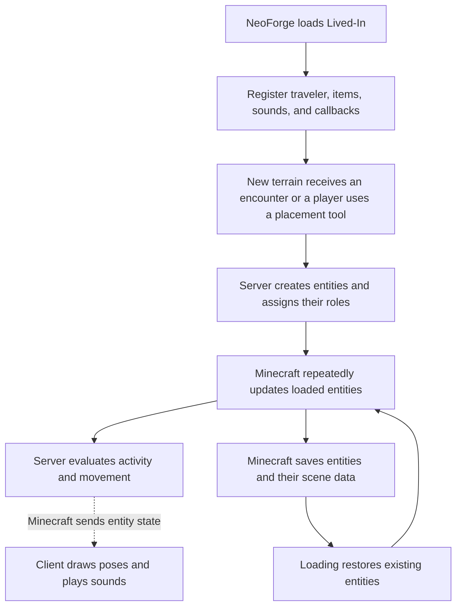
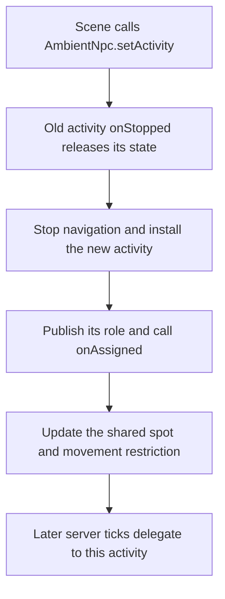
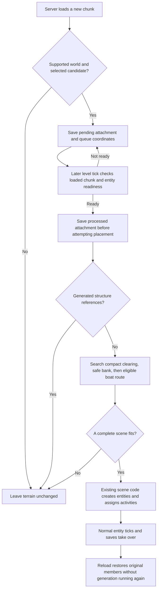
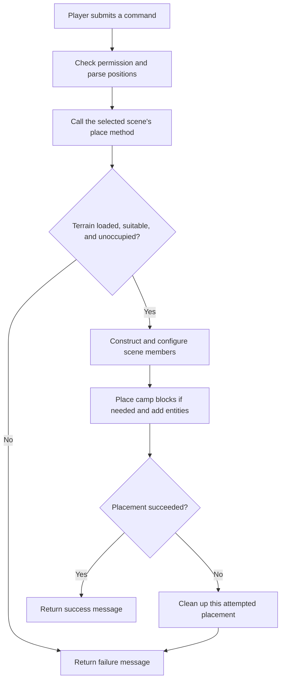
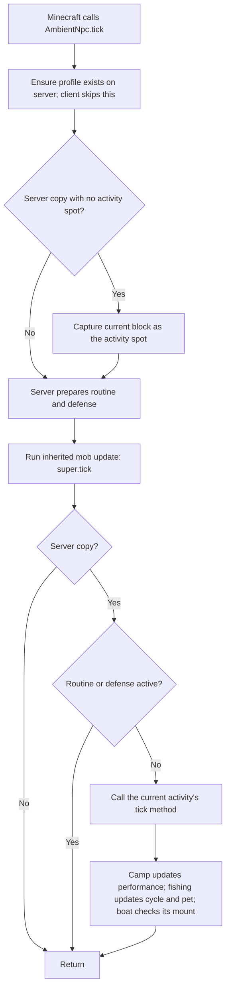
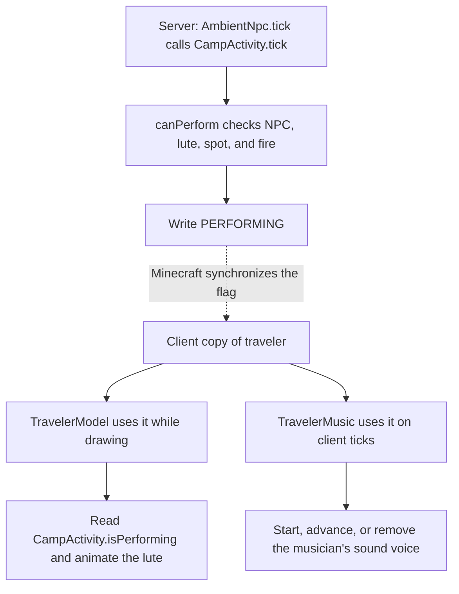
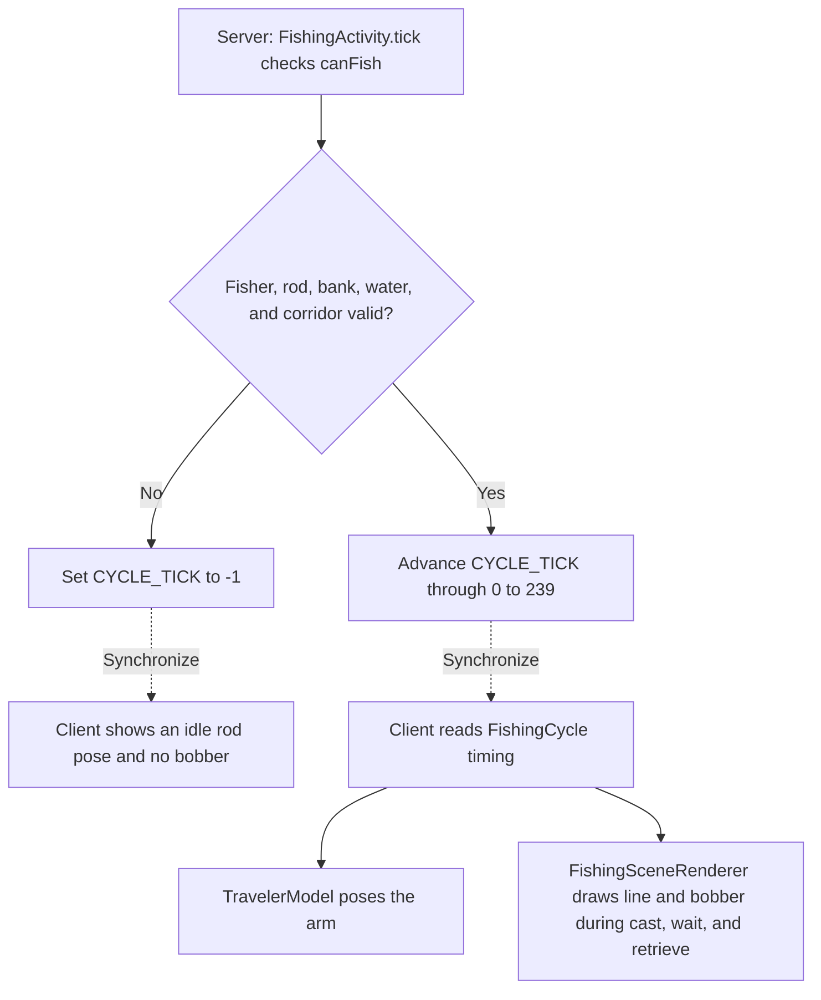
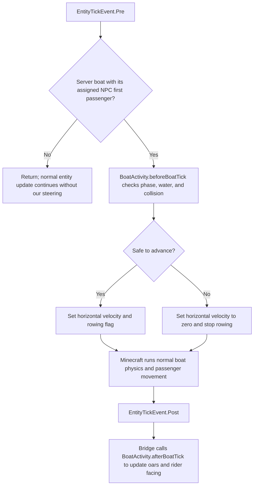
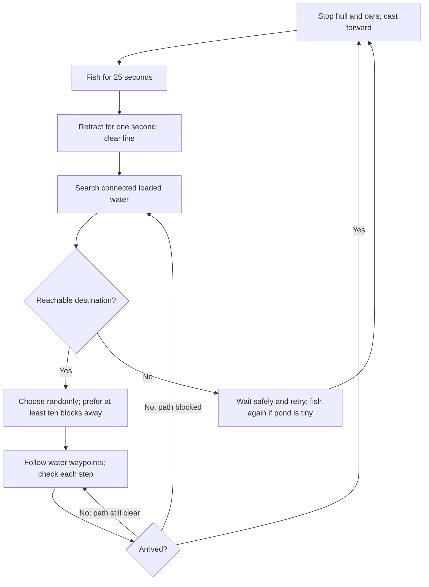
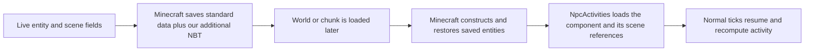

# Lived-In: Phase 1 code rundown

Last updated: 2026-10-17

This guide explains the current Minecraft 1.21.1 / NeoForge implementation, assuming you know basic Java but have never made a mod. The code walkthrough describes working behavior; the closing scope note identifies planned milestones separately. Click an unfamiliar linked term to jump to its definition in the [glossary](#glossary).

Read alongside the [gameplan](C:/Lived-in/Documents/GAMEPLAN-Phase1.md) for scope and the [development guide](C:/Lived-in/Documents/Lived-in-Development.md) for setup, commands, and verification history. The flowcharts use Mermaid; open this file in a Markdown preview that supports Mermaid to see them as diagrams.

## 1. The overall idea

Lived-In adds one custom traveler [entity type](#g-entity-type). Every traveler is an instance of the same Java class, `AmbientNpc`, and owns one [activity component](#g-composition). That component supplies the role and rules for an ordinary traveler, musician, camp companion, fisher, or boat rider.

[NeoForge](#g-neoforge) loads our code into Minecraft and provides places to connect it to the game. Minecraft supplies movement, health, saving, boats, cats, and many drawing tools. This existing game behavior is called [vanilla](#g-vanilla) behavior. Our code supplies scene placement, activity rules, presentation, and music.

The mod has no ordinary Java `main()` method and no loop that runs the whole project. Minecraft and NeoForge call our methods at the appropriate times. This is [callback](#g-callback) based [control flow](#g-control-flow).

Even singleplayer contains a [server](#g-server) and a [client](#g-client). The server decides what happens in the world. The client draws it and plays sounds. They run inside the same game process in singleplayer, but have separate responsibilities and world objects.



The dotted arrow represents data being sent, not a direct call from a server method into a rendering method. These systems run on different schedules: simulation uses [ticks](#g-tick), while drawing uses [frames](#g-frame).

## 2. How the mod starts

Start with [LivedIn.java](C:/Lived-in/src/main/java/dev/livedin/LivedIn.java). Its `@Mod(LivedIn.MOD_ID)` [annotation](#g-annotation) identifies it as the entry point for `livedin`.

NeoForge reads the packaged `META-INF/neoforge.mods.toml` [metadata](#g-metadata), checks dependencies, and constructs `LivedIn`. The source template is [neoforge.mods.toml](C:/Lived-in/src/main/templates/META-INF/neoforge.mods.toml); Gradle fills in its version and identity values during the build.

The `LivedIn` constructor calls `ModContent.register(modBus)` and `NaturalEncounters.register(modBus)`, attaches two setup listeners, and writes a startup log message. Actual placement happens later when terrain becomes ready or a player uses a placement tool.

| Method or class | Who calls it? | Responsibility |
| --- | --- | --- |
| `LivedIn(IEventBus)` | NeoForge during mod loading | Connect common setup code to NeoForge. |
| `ModContent.register()` | The `LivedIn` constructor | Attach queued entity, item, and sound registrations. |
| `LivedIn.registerAttributes()` | NeoForge's `EntityAttributeCreationEvent` | Attach the traveler's default health, speed, and sensing range. |
| `LivedIn.addCreativeItems()` | NeoForge's `BuildCreativeModeTabContentsEvent` | Add the egg to Spawn Eggs and the lute to Tools & Utilities. |
| `ClientEvents.registerRenderers()` | NeoForge's `EntityRenderersEvent.RegisterRenderers` | Connect our traveler type to its client renderer. |
| `ClientEvents.registerModels()` | NeoForge's `ModelEvent.RegisterAdditional` | Make the existing cast fishing-rod model available to our drawing code. |
| `ModCommands.register()` | NeoForge's `RegisterCommandsEvent` when commands are assembled | Register the three `/livedin` scene commands. |

[ModContent.java](C:/Lived-in/src/main/java/dev/livedin/registry/ModContent.java) uses a [registry](#g-registry), through `DeferredRegister`. “Deferred” means the definitions are queued until NeoForge's registration stage. A returned `DeferredHolder` is a reference to a definition that becomes available during loading.

Our registered IDs are `livedin:ambient_npc`, `livedin:ambient_npc_spawn_egg`, `livedin:lute`, and `livedin:lute_note`. The `livedin:` prefix is our [namespace](#g-namespace), which separates our names from Minecraft's names and other mods.

An [event bus](#g-event-bus) distributes events to listeners. The mod bus handles setup events. The game bus handles runtime events such as command registration and entity/client ticks. `@EventBusSubscriber` and `@SubscribeEvent` connect annotated static handlers automatically; they do not need a manual call from `LivedIn`.

[ClientEvents.java](C:/Lived-in/src/main/java/dev/livedin/client/ClientEvents.java) is restricted to `Dist.CLIENT`, so a server without graphics does not load our rendering and sound controller through those subscriptions.

## 3. Where an NPC is defined and where one is created

[AmbientNpc.java](C:/Lived-in/src/main/java/dev/livedin/entity/AmbientNpc.java) extends Minecraft's `PathfinderMob`. Through [inheritance](#g-inheritance), it receives normal mob behavior such as health, equipment, collision, and navigation. We customize selected methods with [overrides](#g-override).

There are three different steps:

1. `ModContent` registers the **type**: a reusable definition of a traveler.
2. Minecraft's spawn egg, `/summon`, world loading, or our scene code constructs an **instance**: one particular traveler.
3. The instance is added to a world, where Minecraft can update it, show it to players, and save it.

The expression `AmbientNpc::new` in `ModContent` is a constructor reference. It tells the entity type how to create an instance when one is needed.

This shortened sequence comes from camp placement; the real code also checks failures:

```java
AmbientNpc npc = ModContent.AMBIENT_NPC.get().create(level);
npc.moveTo(location.x, location.y, location.z);
npc.setActivity(new CampActivity(NpcRole.MUSICIAN, center), spot);
npc.setItemSlot(EquipmentSlot.OFFHAND, new ItemStack(ModContent.LUTE.get()));
level.addFreshEntity(npc);
```

`create()` constructs the object. `moveTo()` sets its initial location. `setActivity()` installs its CampActivity and assigned spot. `setItemSlot()` gives this individual a lute. `addFreshEntity()` makes it part of the server world.

The `AmbientNpc` constructor marks the NPC as persistent, meaning distance alone should not make it disappear. It does not choose the final spawn location. For an ordinary traveler, the first server `tick()` records that location as its activity spot after positioning is complete.

| Characteristic | Where to change it | Current behavior |
| --- | --- | --- |
| Health, strength, movement speed, sensing range | `AmbientNpc.createAttributes()`, `NpcStats`, `NpcProfile.apply()` | [Attributes](#g-attribute): profiles apply 16–30 health, 1–4 melee damage, and 90–110% walking pace. Follow range stays 16; goals may use their own range. |
| Physical dimensions | `ModContent.AMBIENT_NPC` builder | Width 0.6, height 1.8, eyes at 1.62 blocks. |
| Position when sitting in a vehicle | Same entity-type builder | Uses `Player.DEFAULT_VEHICLE_ATTACHMENT` to align seated hips with the boat. |
| Behavior priorities | `AmbientNpc.registerGoals()` | Adds the movement, activity, and looking goals described below. |
| Assigned place | `AmbientNpc.setActivitySpot()` | Stores a block position, updates the movement restriction, and stops the current path. |
| Role and activity assignment | [NpcRole.java](C:/Lived-in/src/main/java/dev/livedin/entity/NpcRole.java), `AmbientNpc.setActivity()` | Activity supplies a stable role: traveler 0, musician 1, companion 2, fisher 3, boat rider 4. |

`NpcRole` is a Java `enum`: a fixed set of named choices. Its `fromId()` method falls back to an ordinary traveler for an unknown ID. Existing IDs must stay stable because worlds save those numbers.

### Composition: each activity owns its details

`AmbientNpc` keeps common health/equipment behavior, identity, the shared activity spot, and the connection to Minecraft. It has no fishing target, pet UUID, campfire position, or boat-route fields. Those belong to the current activity object.

Phase 2 milestone 1 adds a separate [NpcProfile](C:/Lived-in/src/main/java/dev/livedin/entity/profile/NpcProfile.java): saved name, background/personality, stats, permissions, and a home request. `getProfile()` creates it on the first server tick/save, after scene assignment; loading restores it or initializes an older NPC once. [NpcStats](C:/Lived-in/src/main/java/dev/livedin/entity/profile/NpcStats.java) owns ranges and movement conversion; [NpcEligibility](C:/Lived-in/src/main/java/dev/livedin/entity/profile/NpcEligibility.java) owns independent yes/no permissions. Changing the activity leaves this personal profile alone.

Phase 2 milestones 2–6 add `NpcRoutine`, `NpcDefense`, and `NpcRelationships`, plus world-level `Neighborhoods` and `Invitations` records. `AmbientNpc.tick()` prepares the schedule/defense before `super.tick()` selects goals; daytime activity runs only when neither overrides it. Activities expose `onPaused()`/`onResumed()` hooks to stop casts while preserving scene associations. Defense and routine goals take priority over the daytime goals described below. See the [development guide](C:/Lived-in/Documents/Lived-in-Development.md) for the complete new flow.

`NpcDefense` saves one equally likely sword, axe, or bow choice per person and keeps daytime equipment aside while that weapon is needed. Camp companions always show their weapon. `DefendGoal` either shoots a bow or approaches and swings a melee weapon using Minecraft's attack method. `NpcRoutine` owns temporary night fires and their standing positions, removes owned fires at dawn, and returns boat riders to their original boat after shore camping. These rules live outside the daytime activities so fishing code does not need to implement combat or overnight cleanup. Natural camp opportunities now receive the earlier 25% check followed by a further 10% check: 2.5% of the original opportunities, or one tenth of the preceding build's rate. Fisher/boat opportunities and existing saved camps remain.

`AmbientNpc.mobInteract()` is Minecraft's right-click callback: it delegates a valued-item offer to `NpcRelationships`, or opens `ConversationMenu` after that player's 20 points. `ConversationScreen` displays a saved snapshot. The server's menu-button callback validates the request and asks the world invitation registry to issue one personal item. NPC death invalidates that claim and drops no loot. Player villages and construction remain later milestones.

| Component | Responsibility |
| --- | --- |
| [NpcActivity](C:/Lived-in/src/main/java/dev/livedin/entity/activity/NpcActivity.java) | Java interface defining the common methods every activity can provide: role, movement rules, holding/looking, assignment, update, cleanup, and saving/loading. |
| [TravelerActivity](C:/Lived-in/src/main/java/dev/livedin/entity/activity/TravelerActivity.java) | Ordinary walking and looking defaults, with no scene-specific state. |
| [CampActivity](C:/Lived-in/src/main/java/dev/livedin/entity/activity/CampActivity.java) | Fire association, safe camp positions, companion/musician rules, and performance state. |
| [FishingActivity](C:/Lived-in/src/main/java/dev/livedin/entity/activity/FishingActivity.java) | Shore/pet rules and its FishingCast component. |
| [BoatActivity](C:/Lived-in/src/main/java/dev/livedin/entity/activity/BoatActivity.java) | Boat identity, fish/travel cycle, steering, FishingCast, and recovery/cleanup. |
| [FishingCast](C:/Lived-in/src/main/java/dev/livedin/entity/activity/FishingCast.java) | Shared synchronized cast target/counter; no shore, pet, or steering rules. |
| [NpcActivities](C:/Lived-in/src/main/java/dev/livedin/entity/activity/NpcActivities.java) | Construct a component from a role, restore its saved fields, and initialize synchronized data definitions. |



Changing activity does not construct another NPC. Even replacing one FishingActivity with another clears/replaces the previous target and association. Camp cleanup clears performance, fishing cleanup clears client-visible water/cycle state and stops maintaining the old cat, and boat cleanup releases its own mount and stops the original empty loaded boat. Existing cats/boats and equipment are retained.

Minecraft's synchronized data has a fixed schema for the one traveler type. The components own their keys, but `AmbientNpc` initializes all definitions through `NpcActivities` before constructing the first entity. `activityDataKey()` allocates keys for the correct Minecraft entity class. On clients, `getActivity()` builds a lightweight component view from the synchronized role; presentation reads synchronized fields, and server activity decisions never run there. Adding an activity requires its component and factory entry, plus any necessary synchronized definitions and presentation; the shared entity does not need more unrelated fields.

## 4. How a command becomes a scene

### How new terrain becomes a scene

[NaturalEncounters.java](C:/Lived-in/src/main/java/dev/livedin/world/NaturalEncounters.java) receives NeoForge's chunk-load and level-tick [callbacks](#g-callback). It retains the boat candidate per 128 by 128-block region and adds four land candidates, one per 64 by 64-block cell, using the world [seed](#g-seed). Extra land candidates cannot create boats. Overlapping candidates are processed once. Only new, non-flat Overworld chunks receive requests, queued until a later server tick.



An [attachment](#g-attachment) adds saved data to an existing Minecraft object. `NaturalEncounters.register()` registers `livedin:encounter_state` for chunks. Value 1 means pending and value 2 means processed. Both success and rejection consume the request. Removing a member does not change that marker, so a later visit does not replace them.

[EncounterPlacement.java](C:/Lived-in/src/main/java/dev/livedin/world/EncounterPlacement.java) owns terrain search. It uses a [heightmap](#g-heightmap) to find the surface, tries a compact 7 by 7 camp clearing first, then safe fishing footing/casts, then a boat where the boat grid permits one. Camps fit gentle terrain with local heights for members and props. Manual camps retain the 9 by 9 layout. Unsuitable terrain stays unchanged. `getChunkNow()` reads loaded chunks without production loading tickets. Unload callbacks clean the queue; saved pending requests can resume later.

[ModCommands.java](C:/Lived-in/src/main/java/dev/livedin/command/ModCommands.java) defines command names, arguments, and the code to run after parsing. Registering a command does not execute it. The `.executes(...)` [callback](#g-callback) runs later when someone issues that command.

All three commands require operator permission level 2. In an isolated singleplayer test world, enable commands to use them.

| Command | Handler inside `ModCommands` | Placement code and responsibility |
| --- | --- | --- |
| `/livedin camp [center]` | `place()` | [CampfireScene.place()](C:/Lived-in/src/main/java/dev/livedin/scene/CampfireScene.java): validate a 9 × 9 area; create a fire, benches, supplies, a musician, and two companions. |
| `/livedin fishing <shore> <water>` | `placeFishing()` | [FishingScene.place()](C:/Lived-in/src/main/java/dev/livedin/scene/FishingScene.java): validate bank/water; create and link a fisher and cat. |
| `/livedin boat <start> <end>` | `placeBoat()` | [BoatScene.place()](C:/Lived-in/src/main/java/dev/livedin/scene/BoatScene.java): validate the route; create a vanilla boat and mount a traveler. |



If camp placement fails partway through, `rollback()` removes the new members and matching camp blocks. Fishing and boat placement remove their new entities if insertion or mounting fails. They do not excavate water or modify terrain.

The placement classes run on demand. They are not scene managers that run forever. After placement, the entities and Minecraft's ordinary world systems keep the activity going. Revisiting a scene does not call its placement method again.

## 5. The traveler's repeating update

Minecraft calls `AmbientNpc.tick()` for a ticking traveler. That method runs on server and client copies, but its world decisions are guarded by `!level().isClientSide`.



`super.tick()` preserves Minecraft's inherited update behavior. The inherited mob machinery also runs the server's [goal selector](#g-goal), which decides which goals can operate together. After that, only the current activity's `tick(npc)` runs; an ordinary TravelerActivity has no extra update work. `AmbientNpc` does not branch over all roles itself.

The activity area uses block positions and distance checks: ordinary travelers have a six-block radius, camp companions two, and musicians/fishers one. The comparison is strictly inside that radius; a radius of one effectively anchors activity to the assigned block. Camp positions must also remain at least two blocks horizontally from the fire, and fisher positions must pass dry-shore checks.

### How goals are selected

`registerGoals()` supplies these priorities. Lower numbers win when goals compete for the same control, such as movement or looking. It is not a sequence where every row always executes in order; compatible goals may run together.

| Priority | Goal and source | Responsibility |
| --- | --- | --- |
| 0 | Minecraft's `FloatGoal` | Try to float in water. |
| 1 | [ActivityGoal](C:/Lived-in/src/main/java/dev/livedin/entity/goal/ActivityGoal.java) | Ask the activity whether to hold position, stop navigation on start, and call its hold/look behavior. Camp musicians face the fire; fishers face water even when casting is paused. |
| 2 | [ReturnToActivitySpotGoal](C:/Lived-in/src/main/java/dev/livedin/entity/goal/ReturnToActivitySpotGoal.java) | Attempt a safe path home after displacement; retry at intervals. |
| 3 | [SceneStrollGoal](C:/Lived-in/src/main/java/dev/livedin/entity/goal/SceneStrollGoal.java) | Choose occasional short walks; reject paths leaving the activity area. Musicians, fishers, and passengers do not stroll. |
| 4 | Minecraft's `LookAtPlayerGoal` | Look at nearby players within eight blocks. |
| 5 | [ActivityLookGoal](C:/Lived-in/src/main/java/dev/livedin/entity/goal/ActivityLookGoal.java) | Occasionally look at an activity-provided idle target; CampActivity supplies its fire. |
| 6 | Minecraft's `RandomLookAroundGoal` | Provide ordinary idle looking. |

Minecraft calls `canUse()` to check whether a goal can begin, `start()` when it begins, `tick()` while active, `canContinueToUse()` to check whether it may continue, and `stop()` when it ends. Some of these methods are inherited rather than overridden in each class.

The two activity goals remember the exact component object that started them. If `setActivity()` replaces it, they stop using that old component. `SceneStrollGoal` asks `allowsStrolling()`, and path safety/radius checks delegate to the activity too.

[Navigation](#g-navigation) computes and follows routes. Our stroll goal checks every position along a proposed path, not just its destination. The return goal rejects paths through campfire clearance or unsafe fisher ground. It attempts walking; it does not teleport ordinary displaced travelers home.

## 6. Campfire: from a lit fire to music

`CampfireScene.place()` assigns `MUSICIAN` to one traveler, equips a lute in the offhand, and gives each member a saved campfire spot and activity spot. The other two receive `CAMP_COMPANION`.

On the server, `CampActivity.canPerform(npc)` requires a living musician at its activity area, holding the lute, outside water and vehicles, with a loaded, lit, non-waterlogged campfire. ActivityGoal uses this check through `canHoldPosition()`, and CampActivity's own `tick()` writes its result into `PERFORMING`.

`PERFORMING` is [synchronized entity data](#g-sync). Minecraft sends it to clients. Both the playing pose and music read the received value; they do not independently decide whether the campfire is lit.



### Who calls the sound code?

1. NeoForge emits `ClientTickEvent.Post` after a client tick.
2. `ClientEvents.clientTick()` calls [TravelerMusic.tick()](C:/Lived-in/src/main/java/dev/livedin/client/sound/TravelerMusic.java).
3. `TravelerMusic` finds loaded, living, performing, non-silent travelers within 24 blocks of the player.
4. It keeps one `Voice` object per musician [UUID](#g-uuid) and calls that voice's `tick()`.
5. The voice asks `CampfireMelody.playbackAt(worldGameTime)` for the current note and its timing.
6. If the note's start tick changed, it stops the old sound and plays one new `LuteNoteSound`, unless the score entry is a rest.
7. Minecraft's sound engine calls `LuteNoteSound.tick()` while that sound instance remains active.

A “voice” here is just a small Java object holding one musician's current playback state. It is not dialogue. `lastOnset` remembers the note's start tick, so repeated client updates do not pluck the same note again.

[LuteNoteSound.java](C:/Lived-in/src/main/java/dev/livedin/client/sound/LuteNoteSound.java) sets volume to `0.45`, updates the sound position to follow the NPC, and stops at the note's end or when performance becomes invalid. `SoundSource.NEUTRAL` places it under Friendly Creatures volume. Normal distance fading makes it quieter away from the musician; the 24-block controller range is not a promise of audibility at that distance.

`TravelerMusic` removes voices for missing, distant, or inactive musicians. Changing worlds stops and clears all voices. Paused gameplay does not advance its scheduling. Together, these rules prevent extra loops from stacking after revisits.

### How the melody is represented

[CampfireMelody.java](C:/Lived-in/src/main/java/dev/livedin/scene/CampfireMelody.java) is a calculation helper. It does not play audio or own a world. Both `TravelerMusic` and `TravelerModel` ask it which note should be active now.

`SCORE` contains the supplied twelve-bar melody: 64 notes at 92 [BPM](#g-bpm), about 31.30 seconds per loop. Each `Note` stores a [MIDI](#g-midi) pitch and duration measured in eighth notes. For example, `n(C3, 2)` means C3 for a quarter-note interval; duration `3` is a dotted quarter and `4` is a half note. `REST` represents silence.

`START_EIGHTHS` stores the accumulated start time of every note. `playbackAt()` converts world time to a repeating score position, finds the containing note, and returns a `Playback` [record](#g-record) with its start, end, and progress. This avoids adding a rounding error to each loop. Actual starts still follow the game's tick timing.

`pitch()` converts the MIDI note to a playback-speed multiplier relative to Minecraft's F#3 guitar sample. [sounds.json](C:/Lived-in/src/main/resources/assets/livedin/sounds.json) connects `livedin:lute_note` to `minecraft:block.note_block.guitar`. A long note delays the next pluck; the sample itself naturally fades.

All musicians use the world clock, so returning joins the current part of the melody rather than restarting at bar one. The sheet's chord labels do not add extra chord accompaniment.

## 7. Fishing: a timed activity and a linked cat

`FishingScene.place()` validates safe dry footing for the fisher and cat, exposed [source water](#g-source-water) directly beside the bank in the casting direction, one block below the feet, and a clear cast to a target three to five blocks into the water. Casting distance does not mean distance from the shoreline. Harmless low plants are accepted; the cat may sit one block higher or lower. It creates the linked fisher/cat, equips the rod, installs FishingActivity, and orders the cat to sit.

There are two separate decisions: ActivityGoal delegates holding/facing to `FishingActivity.canHoldPosition()` and `holdPosition()`; `FishingActivity.canFish(npc)` decides whether the cycle may advance. Facing water does not itself mean a cast is valid.

The server's `AmbientNpc.tick()` calls `FishingActivity.tick(npc)`, which delegates timing to its FishingCast component. If `canFish()` fails, its synchronized counter becomes `-1`; otherwise it advances and wraps at `FishingCycle.LENGTH`. Restoring conditions starts a fresh cycle. Presentation reads `FishingCast.cycleTick(npc)` and `FishingCast.water(npc)`. BoatActivity uses its own FishingCast through the same access points.



[FishingCycle.java](C:/Lived-in/src/main/java/dev/livedin/scene/FishingCycle.java) provides shared timing and drawing calculations:

| Tick range | Activity | What the player sees |
| --- | --- | --- |
| 0–19 | Prepare | Raise the rod. |
| 20–39 | Cast | Move the bobber outward in an arc. |
| 40–199 | Wait | Hold the rod while the bobber gently moves on the water. |
| 200–219 | Retrieve | Bring the bobber back. |
| 220–239 | Rest | Hide the bobber before the next cycle. |

At normal speed, 240 ticks take twelve seconds. There is no fishing loot calculation. The bobber is a temporary client drawing, not a separately spawned entity, so there is no bobber object to save or accidentally duplicate.

### Why the cat stays with this fisher

The fisher saves the cat's UUID in `PetCat`; the cat saves the fisher's UUID in its vanilla `Owner` field. These paired identifiers establish our association. Vanilla player-owner following does not work for an NPC owner, so our code maintains the pet directly.

Older saved fishers without `FishingBankVersion` get one check on their first server tick. If their bank is inland, `repairLegacyBank()` searches loaded positions within six blocks along X/Z and one block vertically for safe waterfront footing and a valid cast. It moves the same NPC, changes its saved activity/water/pet spots, and maintains the same cat association. It writes version 1 on saving. If no suitable bank exists, it leaves the pair in place and pauses fishing; it creates no terrain or replacement entities.

Every 20 server ticks, `FishingActivity.tick(npc)` calls its private `keepPetNearby()`. It looks up only the original, already loaded cat, checks that it is alive and still associated, and orders it to sit. If it is more than 1.5 blocks from its saved pet spot and that spot is safe, it teleports the cat back and stops its movement. Changing to another activity stops that maintenance because this component no longer receives ticks.

A missing or dead cat is not recreated. A missing [chunk](#g-chunk) is not loaded just to find the cat. If the fisher dies, it stops maintaining the pet. This is limited scene behavior, not a full pet-following system.

## 8. Boat: add steering around Minecraft's existing physics

`BoatScene.place()` requires a straight route along X or Z, 4–12 blocks long, at one height. It checks source water and room for the hull/rider along the route. Then it creates a vanilla oak boat and a traveler, installs a BoatActivity containing the boat identity and initial water positions, adds both to the world, and calls `rider.startRiding(boat)`.

The real passenger relationship makes Minecraft carry the rider with the boat. We do not create a custom boat type or redraw a fake boat under the NPC.

[BoatRouteController.java](C:/Lived-in/src/main/java/dev/livedin/scene/BoatRouteController.java) receives NeoForge entity tick events and forwards them to the assigned first passenger's BoatActivity. Its handlers return immediately for clients, non-boats, or boats without the matching activity/boat identity. Steering rules live in BoatActivity; BoatWaterNavigator finds connected water paths. The event bridge owns no movement state.



`BoatActivity` starts by fishing for 500 [ticks](#g-tick), or 25 seconds at normal game speed. This includes preparing and casting once, then holding the waiting pose. It retracts for another 20 ticks before any rowing. It casts two or three blocks ahead of the hull; if that direction faces land, it turns the whole boat to suitable water first. The rider faces with the hull.



[BoatWaterNavigator.java](C:/Lived-in/src/main/java/dev/livedin/entity/activity/BoatWaterNavigator.java) searches neighboring water blocks with a queue. This is a [breadth-first search](#g-bfs): check nearby blocks before farther ones, remembering which block led to each result. Rebuilding that chain gives the waypoints to follow. Every waypoint needs hull clearance, source water, and overhead space. Steps go north, south, east, or west, so they cannot cut diagonally through land. Search is limited to 24 blocks along each horizontal axis and 2,401 checked positions. It reads only loaded water, never requests distant chunks, and cannot cross dry land into another pond.

It randomly chooses among reachable destinations at least ten blocks away. If none exist, it allows a shorter trip of at least two blocks. Without any destination it waits safely. During travel, `beforeBoatTick()` checks water and [collision](#g-collision) again, turns gradually, and supplies velocity to vanilla physics. A new obstacle clears the path and causes a fresh search; unsafe water under the hull stops movement. The initial command endpoints validate placement and starting direction; they no longer restrict later travel.

FishingCast owns the shared synchronized target/counter. `showFrame()` holds the waiting frame while BoatActivity keeps its separate 500-tick timer, then advances through retrieval. Shore fishers retain their twelve-second cycle. Removing the rod, losing casting water, or blocking the line cancels the cast. Existing cleanup and one-time legacy rod upgrades remain. Half-finished casts restart on load; a saved travel destination is replanned using current loaded water. UUIDs, equipment, and real passengers are retained.

`afterBoatTick()` restores the oar flags because vanilla clears rowing for non-player passengers. It also aligns the rider's body/head with the hull. Minecraft synchronizes the resulting boat and passenger state to clients.

Separately, `BoatActivity.tick(npc)` detects a missing or incorrect assigned vehicle. Its `recover()` attempts one nearby safe-shore search if unmounted, then installs TravelerActivity through `npc.setActivity()`. The old BoatActivity's `onStopped()` releases its own mount and stops its original empty boat if loaded. It never spawns a replacement boat, and it cannot guarantee recovery when no shore is available.

## 9. How the client draws the scene

The server does not call drawing methods. Minecraft's rendering system calls the registered [renderer](#g-renderer) when it needs to draw a visible traveler. A frame may be drawn between simulation ticks, so [partial ticks](#g-partial-tick) smooth the appearance between updates.

| Code | Caller | Responsibility |
| --- | --- | --- |
| [AmbientNpcRenderer](C:/Lived-in/src/main/java/dev/livedin/client/AmbientNpcRenderer.java) constructor | Minecraft, using the constructor reference registered by `ClientEvents` | Create the player-shaped model and replace the normal held-item layer with ours. |
| `AmbientNpcRenderer.getTextureLocation()` | Minecraft's inherited rendering code | Choose a vanilla placeholder skin by role and, for companions, identity. |
| `AmbientNpcRenderer.render()` | Minecraft's entity rendering system | Draw the normal mob via `super.render()`, then call `FishingSceneRenderer.render()`. |
| [TravelerModel.setupAnim()](C:/Lived-in/src/main/java/dev/livedin/client/TravelerModel.java) | Inherited mob rendering code during `super.render()` | Begin with vanilla walking/passenger poses; add fishing-arm or lute-holding/strumming poses. |
| [TravelerItemLayer.renderArmWithItem()](C:/Lived-in/src/main/java/dev/livedin/client/TravelerItemLayer.java) | Inherited held-item layer rendering | Position the rod against the hand and the lute against the torso. Other items use normal rendering. |
| [FishingSceneRenderer.render()](C:/Lived-in/src/main/java/dev/livedin/client/FishingSceneRenderer.java) | `AmbientNpcRenderer.render()` after the body is drawn | Calculate the posed rod tip and bobber position, then draw the curved line and bobber image. |

The model chooses **body-part angles**. The item layer chooses **where the held object sits**. Keeping these responsibilities separate lets us correct a lute attachment without changing NPC behavior.

`PoseStack` holds drawing [transforms](#g-transform): position, rotation, and scale changes. `pushPose()` saves the current transform, and `popPose()` restores it afterward so an item's adjustment does not affect unrelated drawing.

The rod tip calculation in `FishingSceneRenderer` matches the rod placement in `TravelerItemLayer`. If the rod's attachment changes, check both places so the line still starts at the tip.

### Resources loaded by Minecraft

[Resources](#g-resource) are data files that Minecraft loads by name; our Java code does not call them like methods.

| Resource | Responsibility |
| --- | --- |
| [lute.json](C:/Lived-in/src/main/resources/assets/livedin/models/item/lute.json) | Describe the lute's blocky shape, texture references, and item display transforms. |
| [ambient_npc_spawn_egg.json](C:/Lived-in/src/main/resources/assets/livedin/models/item/ambient_npc_spawn_egg.json) | Reuse Minecraft's spawn-egg item model. |
| [en_us.json](C:/Lived-in/src/main/resources/assets/livedin/lang/en_us.json) | Provide visible English names and the lute subtitle text. |
| [sounds.json](C:/Lived-in/src/main/resources/assets/livedin/sounds.json) | Map the lute sound event to the vanilla guitar sample. |

Skins, block textures, the cast fishing rod, and the bobber image reference existing Minecraft assets. No external animation library is used.

## 10. What is saved, synchronized, or temporary?

These are different concerns. [Persistence](#g-persistence) means retaining data in a world save. [Synchronization](#g-sync) means sending current state from server to client. Temporary data exists only while the current objects are running.

| Data | Where it lives and how it is used |
| --- | --- |
| Role | `ROLE` is synchronized by AmbientNpc; the current activity supplies it. Its numeric ID is saved as `NpcRole`. |
| Activity and campfire positions | AmbientNpc saves `ActivitySpot`; CampActivity saves `CampfireSpot`. Used by server behavior. |
| Performing flag | `PERFORMING` is synchronized but not saved. Recomputed from the real scene after loading. |
| Fishing target | FishingCast owns synchronized `WATER`; FishingActivity saves its bank target as `FishingWater`. Boat casts use temporary targets. |
| Fishing cycle progress | FishingCast's `CYCLE_TICK` is synchronized but not saved. Assignment/loading resets it to `-1`, ready for a fresh valid cycle. |
| Cat association and spot | FishingActivity saves `PetCat` and `PetSpot`; the cat separately saves its owner UUID. |
| Boat association and destination | BoatActivity saves `SceneBoat` and `BoatTravelTarget` during travel. The old placement keys `BoatStart`, `BoatEnd`, and `BoatHeadingToEnd` are retained for compatibility. |
| Boat pause and rowing helper flags | Temporary server fields. Loading sets a short pause and clears the helper rowing flag. |
| Position, health, identity, equipment, passengers | Minecraft saves its standard entity data, including the real boat/passenger relationship. |
| Music voice, note sound, fishing line, bobber drawing | Temporary client objects/output, never saved as extra scene entities. |

Minecraft calls `AmbientNpc.addAdditionalSaveData()` to write our fields into [NBT](#g-nbt). It saves the common spot/role, `LivedInProfile`, and the current activity's `save()` output. On loading, `readAdditionalSaveData()` restores the activity, profile, and common spot. Profiles apply saved attributes without healing damage or replacing equipment. Older NPCs receive missing profiles once. Both entity methods call `super` so Minecraft retains its own standard fields too.

The old flat NBT keys and numeric role IDs are retained, so earlier worlds load without a save conversion step. Only the current activity writes its specific fields. Assignment resets temporary performance/fishing state; boat loading replans a saved travel destination or begins a fresh fishing stop. If an old save has no activity spot, the next server tick captures one. Equipment is restored by Minecraft; our load code does not hand out a replacement instrument.



Persistent NPCs can still unload with their chunks and can still die. The mod does not keep chunks loaded, rebuild camps on visits, or replace missing cats and boats. That is why saved identities can remain consistent across revisits without multiplying entities.

## 11. Building and checking the code

[build.gradle](C:/Lived-in/build.gradle) configures Java 21, NeoForge, development launches, and a separate `gameTest` [source set](#g-source-set). [gradle.properties](C:/Lived-in/gradle.properties) holds pinned versions and mod identity; [settings.gradle](C:/Lived-in/settings.gradle) configures plugin resolution and the project name.

[Gradle](#g-gradle) compiles the Java and packages main code/resources into the mod [JAR](#g-jar). `generateModMetadata` fills the metadata template. The Gradle wrapper supplies the project's Gradle version. Development tools, saves, caches, and GameTests are excluded from the release JAR.

| Command or helper | When called and responsibility |
| --- | --- |
| `gradlew.bat build` | Developer command: compile main code and tests, then produce `build/libs/livedin-0.1.0-dev.jar`. It does not execute the GameTests. |
| `gradlew.bat runClient` | Developer command: launch Minecraft with the development mod. IntelliJ also has a generated Client launch configuration. |
| `gradlew.bat runGameTestServer` | Developer command: start the test server; the GameTest framework discovers and calls methods annotated with `@GameTest`. |
| [dev-env.ps1](C:/Lived-in/scripts/dev-env.ps1) | Select the local JDK 21 and Gradle cache for a terminal session. |
| [Open-IntelliJ.cmd](C:/Lived-in/Open-IntelliJ.cmd) and [open-idea.ps1](C:/Lived-in/scripts/open-idea.ps1) | Open the project in IntelliJ with the local environment and IDE cache configuration. |
| [prepare-phase1-qa.ps1](C:/Lived-in/scripts/prepare-phase1-qa.ps1) | Prepare the isolated combined test world and world-only verification functions. Not a gameplay feature. |
| [check-phase1-qa.py](C:/Lived-in/scripts/check-phase1-qa.py) | Read recorded test logs and check entity identities, associations, and music voice cleanup. |

The current [GameTests](#g-gametest) live in [src/gameTest/java/dev/livedin/gametest](C:/Lived-in/src/gameTest/java/dev/livedin/gametest). The original 64 scene/profile checks are joined by `HouseTemplateTests` (1), `PhaseTwoLifeTests` (13), `NightTravelTests` (2), and `NeighborhoodLayoutTests` (1): **81 checks**, all passed on 2026-10-17. They cover save compatibility, colors/rotations, home grouping, real night travel, defense, private barter, invitation ownership/death, and rollback. They cannot replace client appearance checks or normal-terrain surveys; those results are recorded in the development guide.

The updated build and all 56 tests passed on 2026-10-15, including random boat trips and directly adjacent shoreline placement/correction. Earlier milestone 6 checks preserved the same 21 scene entities and pet/passenger links. `runEncounterSurvey` runs the development-only [EncounterSurvey](C:/Lived-in/src/gameTest/java/dev/livedin/gametest/EncounterSurvey.java) against fresh normal terrain to record real placement frequency. It loads test chunks, waits for the production hook, releases them, and saves the test world. The initial three seed surveys found all scene types. Two matched follow-up surveys verified the increased camp and shoreline-fisher density; boat placement opportunities stayed on their original grid. The packaged client preserved seven selected scene identities and their associations through unloading and a full restart, including the original boat rider gaining and retaining its rod. Earlier packaged checks inspected mounted casting, return to rowing, and the compact lute camp; see the latest development-guide entry for the random-travel follow-up. See the development guide for results and limits.

## 12. A practical way to follow control flow in IntelliJ

Use a [breakpoint](#g-breakpoint) to pause at a method and inspect who called it. Start with a specific question:

| Question | Useful place to pause or inspect |
| --- | --- |
| Did NeoForge load the mod? | `LivedIn` constructor. |
| Where did this camp come from? | `NaturalEncounters.process()` and `EncounterPlacement.tryPlace()` for natural camps; `ModCommands.place()` for manual camps. |
| Why is the musician silent? | `CampActivity.canPerform()` on the server; then `TravelerMusic.tick()` on the client. Check mute/volume settings too. |
| Why does the lute look wrong? | `TravelerModel.setupAnim()`, `TravelerItemLayer.renderArmWithItem()`, and the lute JSON. |
| Why did fishing stop? | `FishingActivity.canFish()` and `FishingScene.validFishingSpot()`. |
| Why is the boat stationary? | `BoatActivity.beforeBoatTick()`: assigned passenger, fishing/retrieval phase, retry timer, water, and collision checks. |
| Why did saved state change? | `addAdditionalSaveData()` and `readAdditionalSaveData()` in `AmbientNpc`. |

The debugger's call stack shows the active chain of method calls. A tick/render breakpoint may fire very often; a condition on role or entity identity makes it easier to follow one NPC. Pausing the game also pauses the activity you are trying to observe, so resume after inspecting values.

Phase 1 provides ambient scenes with activity composition and natural placement in new normal Overworld chunks. Milestones 0–7 are complete, with natural placement verified on 2026-10-14.

The traveler **has an activity object** that owns its camp, fishing, or boat details, while `AmbientNpc` handles the shared Minecraft connections. Natural placement chooses suitable terrain and creates scenes without player placement commands. Phase 2 now adds homes, daily schedules, defense, barter, conversation, and invitations; the earlier sections focus on the original scenes. Player-performed music, fishing rewards, and long boat journeys remain outside the current scope. See [Phase 2](C:/Lived-in/Documents/GAMEPLAN-Phase2.md) for the later village milestones.

## Glossary

Each linked term above jumps to its row here. Use your preview's Back command to return to your reading position.

| Term | Plain-language meaning |
| --- | --- |
| <a id="g-annotation"></a>Annotation | A Java marker starting with `@`. NeoForge recognizes markers such as `@Mod` and `@SubscribeEvent`; `@Override` tells Java that a method replaces inherited behavior. |
| <a id="g-attachment"></a>Attachment | NeoForge data added to an existing game object; our chunk attachment saves whether natural placement is pending or already processed. |
| <a id="g-heightmap"></a>Heightmap | A table containing a surface height for each horizontal column of blocks. Different tables include different kinds of blocks; ours ignores leaves. |
| <a id="g-seed"></a>Seed | A number used to make repeatable random choices. The same world seed and region coordinates choose the same candidate chunk. |
| <a id="g-attribute"></a>Attribute | A named numeric characteristic of an entity, such as maximum health or movement speed. |
| <a id="g-bfs"></a>Breadth-first search | A search that checks immediate neighbors first, then their neighbors. Remembering each predecessor lets us build a connected path. |
| <a id="g-bpm"></a>BPM | Beats per minute: the tempo of the music. Here, one beat is a quarter note. |
| <a id="g-breakpoint"></a>Breakpoint | A debugger marker that pauses execution at a chosen line so you can inspect values and the chain of callers. |
| <a id="g-callback"></a>Callback | A method you give to a framework so the framework can call it later when something happens. |
| <a id="g-chunk"></a>Chunk | A 16 × 16 column of world blocks. Minecraft loads and unloads chunks so it does not keep the entire world active. |
| <a id="g-client"></a>Client | The part of Minecraft that accepts player input, draws the world, and plays sound. It receives authoritative world state from the server. |
| <a id="g-collision"></a>Collision | Checking whether objects or blocks would overlap and responding to that contact. Our checks help prevent movement into obstacles. |
| <a id="g-composition"></a>Composition | Building an object from focused helper objects that own parts of its state and behavior. A traveler has an activity object and asks it to perform activity work. |
| <a id="g-control-flow"></a>Control flow | The order in which methods and branches execute, including what triggers them and which conditions choose the next step. |
| <a id="g-entity-type"></a>Entity / entity type | An entity is a world object with identity and behavior, such as one NPC or boat. An entity type is the reusable registered definition used to construct those objects. |
| <a id="g-event-bus"></a>Event / event bus | An event announces something, such as a completed client tick. The bus delivers it to registered listener methods. |
| <a id="g-frame"></a>Frame | One image drawn on screen. Frame rate and simulation tick rate are different. |
| <a id="g-gametest"></a>GameTest | A test run inside Minecraft's test framework, able to create entities/blocks, advance ticks, and check results. |
| <a id="g-goal"></a>Goal / goal selector | A goal is one possible mob behavior. The selector checks priorities, conditions, and control flags to decide which goals may run together. This is rule-based game behavior. |
| <a id="g-gradle"></a>Gradle / wrapper | Gradle builds and launches the development project. The wrapper scripts download and use the project's chosen Gradle version. |
| <a id="g-inheritance"></a>Inheritance | A Java class extends another class to reuse and customize its behavior. `AmbientNpc` extends Minecraft's `PathfinderMob`. |
| <a id="g-jar"></a>JAR | A Java archive containing compiled classes and resources. Our mod is distributed as one JAR file. |
| <a id="g-metadata"></a>Metadata | Information describing the mod, such as its ID, name, version, and required dependencies. It does not implement NPC behavior. |
| <a id="g-midi"></a>MIDI pitch | A standard numeric note name: middle C is 60, and each increase of one is a semitone. We use the numbers, not an external MIDI player. |
| <a id="g-namespace"></a>Namespace | A prefix that identifies who owns a resource name. `livedin:lute` belongs to this mod; `minecraft:cat` belongs to Minecraft. |
| <a id="g-navigation"></a>Navigation / pathfinding | Calculating a route through the world and moving an entity along it. A path is a sequence of positions to visit. |
| <a id="g-nbt"></a>NBT | Named Binary Tag: Minecraft's structured data format for saved world and entity information. Think of named fields stored in a file. |
| <a id="g-neoforge"></a>NeoForge / mod loader | Software that loads mods into Minecraft and provides events, registries, and other integration tools. |
| <a id="g-override"></a>Override / super | An override customizes a method inherited from a parent class. `super.method()` calls the inherited implementation so its normal work can still happen. |
| <a id="g-partial-tick"></a>Partial tick | A fractional position between simulation ticks, used to make animation and motion look smooth between updates. |
| <a id="g-persistence"></a>Persistence | Keeping important state across saving and loading. Minecraft's persistent-mob setting also prevents ordinary distance-based despawning, but not death or chunk unloading. |
| <a id="g-record"></a>Record | A Java type designed to carry a fixed set of values, such as one note's pitch, start time, and end time. |
| <a id="g-registry"></a>Registry | Minecraft's lookup table from names to definitions, such as `livedin:ambient_npc` to our traveler type. |
| <a id="g-renderer"></a>Renderer / model / layer | A renderer coordinates drawing. A model provides shape and pose. A layer adds an extra part, such as a held item. |
| <a id="g-resource"></a>Resource / asset | A data file used by the game, such as a model, texture, translation, or sound definition. It is not executable Java code. |
| <a id="g-server"></a>Server | The part of Minecraft responsible for world simulation and decisions. Singleplayer starts an integrated server locally. |
| <a id="g-source-set"></a>Source set | A named group of code/resources in a Gradle project. `main` is the mod; `gameTest` is the separate development-test group. |
| <a id="g-source-water"></a>Source water | A full source block of water, rather than a flowing water block. The scene checks require this stable water surface. |
| <a id="g-sync"></a>Synchronization / synchronized entity data | Sending an entity's state from server to clients using Minecraft's existing mechanism. Here this does not mean Java's `synchronized` thread-locking keyword. |
| <a id="g-tick"></a>Tick | One simulation update. Minecraft normally targets 20 per second, so one tick normally represents 0.05 seconds. |
| <a id="g-transform"></a>Transform | A change to drawing position, rotation, or scale. A transform affects presentation, not the entity's physical world position. |
| <a id="g-uuid"></a>UUID | A unique identifier for one entity. Saved UUID references let us find the same cat, boat, or traveler again rather than creating a replacement. |
| <a id="g-vanilla"></a>Vanilla | Minecraft's built-in content or behavior, such as its normal cat, boat, physics, or player model. |
