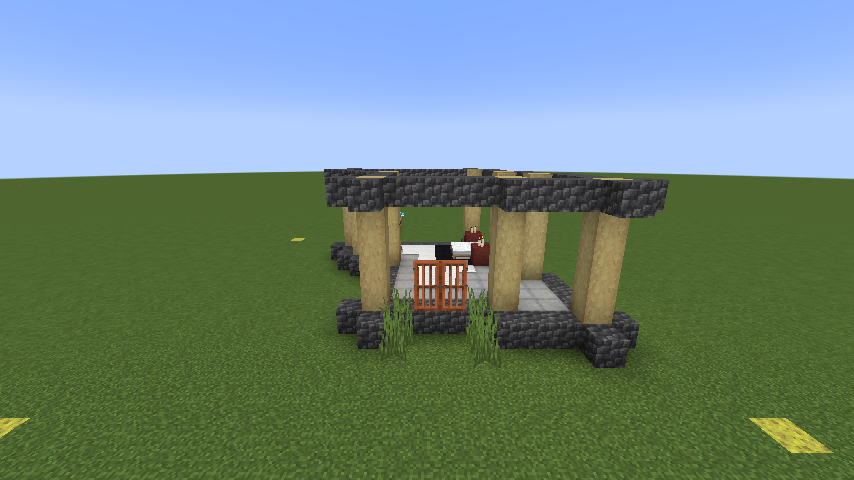

# Starter House — design handoff

Last updated: 2026-10-17

Captured from the user's `house_creation` world. Working name: **Starter House**. The original build was inspected in Minecraft and remains intact. This document records this particular house; [GAMEPLAN-Phase2.md](../GAMEPLAN-Phase2.md) remains the milestone plan.



## What was captured

- Source: `C:\Lived-in\run\saves\house_creation`, Overworld.
- Sponge corners: **(-4, -61, -3), (-4, -61, 16), (16, -61, -3), (16, -61, 16)**.
- The marker coordinates cover **21 × 20** columns inclusively. The easternmost column, X=16, is empty above the sponge level. Omitting that empty column produces a 20 × 20 plot without removing any part of the house.
- Export bounds, inclusive: **(-4, -60, -3) through (15, -55, 16)**.
- Size: **20 × 6 × 20** (width × height × depth).
- The export starts **one block above the sponges**, as requested. It excludes sponges and underlying terrain, but preserves everything built above them, including the open roof/walls, plants, furniture, and beams.
- There are **237 non-air blocks**, including two beds, 14 white carpets, six black carpets, two doors, and six empty chests. Beds and doors each occupy two blocks. No mobs, dropped items, or other entities were captured.
- All six chests were empty in the saved source. No chest items were removed from the original world.

The source was copied into the ignored `build/house-import/source-backup` before inspection. The export reads that closed snapshot; it never edits region files in the original world. `build/house-import/source-report.json` records the full marker area; `export-report.json` records the normalized 20 × 20 capture.

## Front, bed, and placement coordinates

The double doors define the **south-facing front**: a visitor approaches from positive Z and looks north. The doors' own block-state `facing=north` is their Minecraft hinge/orientation detail; it does not mean the outside of the house is its north side.

Local coordinates start at the minimum exported corner. Add these coordinates to the placement origin for the unrotated house. Rotate them with the same transform as the blocks when placing other orientations.

| Feature | Local X, Y, Z |
| --- | --- |
| First door, lower half | 11, 1, 14 |
| Second door, lower half | 12, 1, 14 |
| Ground immediately outside the doors | 11, 0, 15 and 12, 0, 15 |
| First bed foot / head | 13, 1, 7 / 14, 1, 7 |
| Second bed foot / head | 13, 1, 8 / 14, 1, 8 |

Place on level solid ground one block below local Y=0. The house floor is at local Y=0 and the doorway feet are at Y=1, so approaching from outside includes a one-block step up. The template includes surrounding air: future construction must validate the full plot before placing it, so it cannot erase a player's unrelated build. Clearing or adapting uneven terrain and NPC navigation through doors belong to the later housing milestones.

## Wool colors

All 16 vanilla wool colors have exported templates. Only these original blocks change:

- Both **white beds**, including their head and foot halves.
- All **14 white carpet blocks**.

Black carpets, smooth stone, candles, wood, doors, and every other block keep their original appearance. Rotation/facing, bed parts, chest contents, and other block properties are preserved. Choosing black wool therefore produces 20 black carpet blocks: the six original black carpets plus 14 recolored accents.

The base template remains white. Natural homes now use this design; the colored variants are ready for the later construction screen to select. No wool-input or player-village construction UI exists yet.

## Files and regeneration

- [Base structure](../../src/main/resources/data/livedin/structure/houses/starter_house.nbt): ID `livedin:houses/starter_house`.
- [Color variants](../../src/main/resources/data/livedin/structure/houses/starter_house): IDs `livedin:houses/starter_house/<color>`, for example `livedin:houses/starter_house/blue`.
- [Design metadata](Starter-House.json): source corners, entrance/bed positions, exact accent positions, counts, and color-to-template mapping. `HouseCatalog` now registers the corresponding design; the JSON remains the handoff record.
- [Importer](../../scripts/import-house-design.py): standard-library Python script that reads a closed source save, preserves block data, excludes entities, checks the empty-border trim, and writes vanilla structure NBT. It refuses to replace a different existing export.

To reproduce the current export from the saved snapshot:

```powershell
python scripts/import-house-design.py --source build/house-import/source-backup --trim-empty-max-x --output src/main/resources/data/livedin/structure/houses/starter_house.nbt --color-variants
```

For a revised design, save and close its world, then capture a new snapshot and export to a new file for comparison. Do not overwrite the original design or silently reuse a stale snapshot.

In a separate Creative test world after rebuilding/restarting, a manual preview is possible with `/place template livedin:houses/starter_house ~ ~ ~` or `/place template livedin:houses/starter_house/blue ~ ~ ~`. Place only in an empty plot with suitable ground; this vanilla command has no village ownership or obstruction protection.

## Verification and limits

The source was inspected in Minecraft, including the double-door front. Source and exported block counts match, and the normalized edge contained no house blocks. The template preserves the current open design; no roof or walls were invented.

Minecraft placement tests verify the base and every wool-color variant in all four rotations: a 20 × 20 footprint, correct bed/door orientation, both bed halves and their block entities, all 14 accent carpets, unchanged black carpets, empty chests, and no sponge markers. Night tests walk an NPC through the doors, into bed, and back out at dawn. Natural homes now use the design on validated fresh terrain. The user confirmed this one house is sufficient for Phase 2, so **milestone 2 is complete**. Additional designs can be registered later; the player construction UI remains milestone 8.
