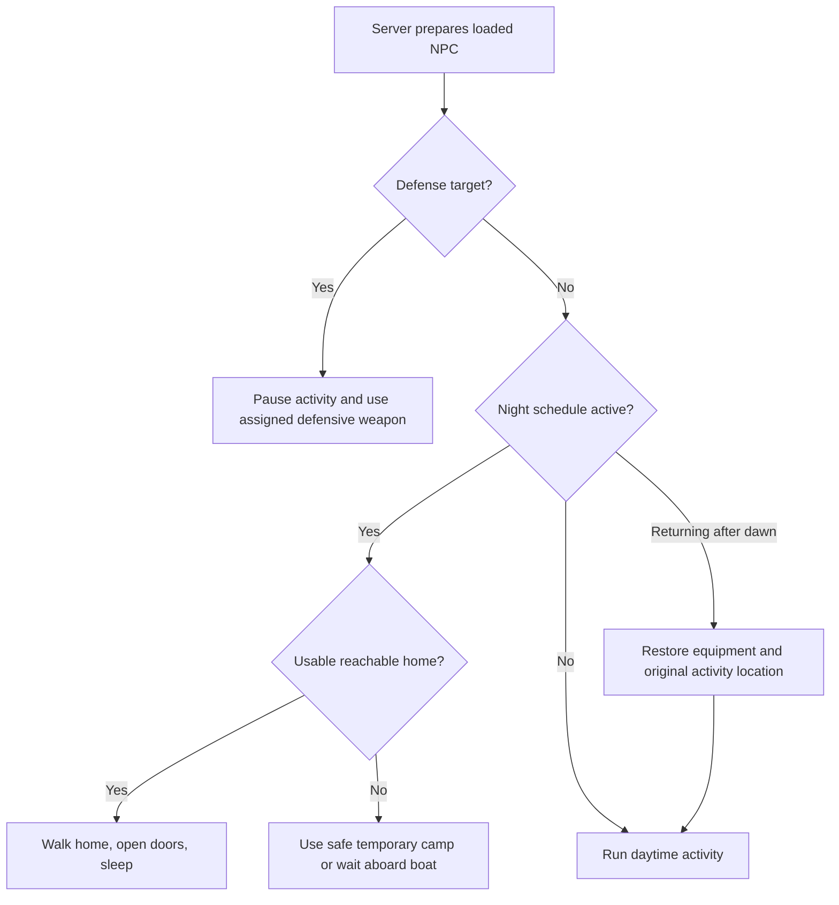
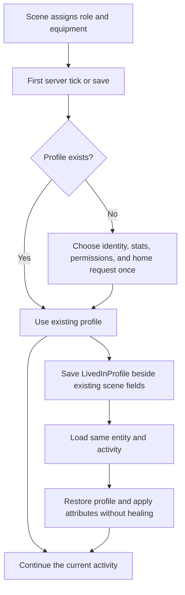

# Lived-In Development

Last updated: 2026-10-17

This guide explains how the project works and how to develop it. The scene ideas and milestones live in [GAMEPLAN-Phase1.md](GAMEPLAN-Phase1.md). Both documents are updated with each relevant project change.

**Phase 2 milestones 1–6 are implemented.** Travelers have profiles, natural homes where terrain permits, night schedules and defense, private barter progress, a conversation screen, and unique personal invitations. The user's Starter House is sufficient for this phase; more designs can be registered later. [GAMEPLAN-Phase2.md](GAMEPLAN-Phase2.md) separates this work from planned player villages, beacon crafting, invitation plots, paid construction, and resident resurrection in milestones 7–10. Its [house handoff instructions](GAMEPLAN-Phase2.md#exact-handoff-on-this-pc) remain available for additional designs.

For a guided walk through the current code, read [Code-Rundown-Phase1.md](C:/Lived-in/Documents/Code-Rundown-Phase1.md). It traces callers, responsibilities, control flow, saving, and client/server behavior with flowcharts and a linked glossary. Keep that explanation aligned with relevant implementation changes; this guide remains the source for setup and verification history.

## Phase 2 milestones 2–6: houses, daily life, and recruitment

An NPC still owns a focused daytime activity. New components handle its schedule, defense, and relationships. `AmbientNpc` connects these objects to Minecraft's callbacks; house and invitation records live at world level because they must remain available while the person is unloaded.

| Code | Responsibility / caller |
| --- | --- |
| [HouseCatalog](../src/main/java/dev/livedin/housing/HouseCatalog.java) | Lists designs, colored structure IDs, entrance/bed positions, rotation transforms, and placement. Contains Starter House now. |
| [Neighborhoods](../src/main/java/dev/livedin/housing/Neighborhoods.java) | Handles new-chunk and later level-tick events, validates fresh sites, builds natural homes, and saves centers, processed sites, requests, and assignments. NPC ticks register one home request. |
| [NpcRoutine](../src/main/java/dev/livedin/entity/life/NpcRoutine.java) | Dusk/dawn state, home travel, sleeping, temporary camps, following cat, docking, and returning to the original daytime anchor. Prepared before inherited NPC ticking; `RoutineGoal` supplies exclusive movement/looking time. |
| [NpcDefense](../src/main/java/dev/livedin/entity/life/NpcDefense.java) and [DefendGoal](../src/main/java/dev/livedin/entity/goal/DefendGoal.java) | Target selection, retaliation, saved weapon choice, reserved equipment, enchantments, melee/bow attacks, and friendly-fire protection. Defense takes priority over routine/daytime goals. |
| [NpcRelationships](../src/main/java/dev/livedin/social/NpcRelationships.java) | Accepts one valued item, drops one food, saves that player's progress, and sends their individual bar update. Called from `AmbientNpc.mobInteract()`. |
| [ConversationMenu](../src/main/java/dev/livedin/social/ConversationMenu.java) | Server-backed introduction/stat snapshot and invite button validation. Minecraft's standard menu system sends open/close/button messages. |
| [ConversationScreen](../src/main/java/dev/livedin/client/ConversationScreen.java) | Client drawing and buttons. Requests an invite through the menu; it never grants an item by itself. |
| [Invitations](../src/main/java/dev/livedin/social/Invitations.java) | Overworld saved registry shared across dimensions: one issued token, owner, and living/dead status per NPC. Server invite buttons issue an item; NPC death invalidates its claim. |
| [SocialEvents](../src/main/java/dev/livedin/social/SocialEvents.java) / [ProgressPayload](../src/main/java/dev/livedin/social/ProgressPayload.java) | Register one clientbound payload and send current progress when a player starts tracking an NPC. No other player's relationship map is sent. |

### Natural houses and adding more designs

The [Starter House handoff](House-Designs/Starter-House.md) records the sponge bounds, 20 × 6 × 20 export, south-facing double doors, two beds, and 14 white carpet blocks. Base plus 16 wool variants are under `data/livedin/structure/houses/`. Only the white beds/carpets change; the six black carpets and other details retain their colors. Minecraft tests place all variants in all rotations. The original build remains intact.

`HouseCatalog.Design` has a stable ID, title, bed location, entrance, and variant-template naming rule. To add another house later, export its blocks and variants, register its design, and verify its coordinates/rotations. Saved homes carry their design ID, origin, rotation, and color, so existing residents keep their original house. Older records without a design ID default to Starter House. No modeling dependency is needed.

Neighborhood membership uses 700 × 700 horizontal regions, with `floorDiv` for negative coordinates. The nominal center can move up to 48 blocks on either axis to find a safe clearing. The chosen center is saved. Up to six homes sit in a compact 3 × 2 layout, 24 blocks between plot origins: a 20-block plot and four-block gap.

Only actual new chunks enter the fresh-site queue. A house requires all footprint chunks to be freshly generated, loaded, and entity-ready. Fresh opportunities expire after 200 simulation ticks. Every ten ticks the queue considers one region, testing at most four new center candidates and placing at most one home. Water, trunks/canopies, steep terrain, surface structures, and existing builds reject a site. Grass/ferns may be cleared; a foundation fills low natural ground by at most three blocks. Deep underground structures do not block nonintersecting surface construction. Production requests no chunk tickets.

Existing eligible NPC home requests have priority within their original region, even while those NPCs are unloaded. Otherwise new local travelers use their own one-time profile roll: a true roll gets a home; false stays homeless. Unsafe/full areas leave requests pending. Unloading, movement, and revisiting cannot reroll them or rebuild a removed house. The center search is bounded, so many wooded/ocean/steep regions receive no homes. A requested home is not a guarantee that a suitable site exists.

World data is `livedin_neighborhoods.dat` in that dimension's data folder. It saves centers, original request anchors, processed opportunities, and UUID-to-home assignments. Missing templates or canceled NPC insertion cannot leave an assigned missing newcomer; failed placement restores the site's original blocks. Natural homes are separate from future player-founded villages. Removing or killing a natural traveler does not respawn them.

#### Why a long flight can find no houses

The 700-block value defines a grid of **possible neighborhoods**, not a guaranteed house every 700 blocks traveled. This is the current algorithm; no house-generation behavior was changed in the camp-rate/key-model follow-up.

1. Split the normal Overworld into 700 × 700 squares. Each square has a nominal center, for example `(350, 350)` for the square from X/Z 0 through 699. Search only 25 center offsets, at 0, ±24, and ±48 blocks along each axis. This does not search the whole square for good land.
2. The first house footprint must pass the terrain checks before a center is saved. Each 20 × 20 footprint needs dry natural ground, at most three blocks of foundation fill, and clear space through the house's height. One obstructing tree trunk, canopy, water column, existing build, surface structure, or entity can reject it. Other plots can fail independently.
3. All chunks touched by that plot must be newly generated, fully loaded, and ready for entities together. Their fresh marks expire after **200 server ticks**, about ten seconds at normal speed. Chunks near the edge of exploration do not always become ready together. Flying quickly can make this timing condition harder to meet. Loading old chunks later does not renew their fresh marks.
4. A valid center offers up to six house plots in a fixed 3 × 2 layout, with four-block gaps. Existing home requests from eligible NPCs in that region get priority, including requests from unloaded NPCs. If none is waiting, create a local traveler and use its saved 50% home roll. A false roll leaves that traveler homeless; the plot opportunity is still spent. The 50% is per person, not a guarantee that half of regions contain neighborhoods.
5. Save failed tested centers and spent plot opportunities. Revisiting does not clear them, restore destroyed houses, or reroll people. This protects explored terrain and player builds, but also prevents later recovery of many missed opportunities.

Consequently, the current implementation is too restrictive to reliably deliver the intended regular neighborhoods. Forests, oceans, and hills can eliminate whole regions. A straight flight can also pass between grid centers without seeing them; the spacing is two-dimensional. Spawn surroundings may have had more complete loading coverage, but we have not diagnosed the exact cause in the user's exploration save. The earlier seed-0 survey found only one house across twelve regions, and two earlier survey seeds found none; those checks already show the density limitation.

A proposed improvement is to keep the 700-block grouping while searching more suitable land within each region, and replace the short global fresh timer with persistent, safe placement opportunities that still protect old builds. Terrain checks would need to tolerate suitable woodland/slopes without overwriting structures. This is a proposal, not implemented behavior or a guaranteed house count.

### Daily schedule, cats, boats, and weapons

World time **12000–23999** is night; **0–11999** is daytime. `NpcRoutine.prepare()` runs before normal goal selection. It pauses the current activity, clears its cast/performance view, and temporarily releases its scene restriction. It never replaces the activity just to go home. `RoutineGoal` walks to a home bed and uses vanilla sleeping. `OpenDoorGoal` opens/closes the wooden double doors. At dawn, including skipped nights, the NPC wakes and returns to its saved activity anchor before resuming. No wall-clock timer is used.



Walking uses short paths through loaded terrain, up to about 24 blocks per waypoint. A distant/unreachable home causes a night camp after a bounded failed-travel interval. Morning routes can wait for terrain or obstacles to become available. NPCs never teleport to distant houses or force-load their route.

A homeless traveler places one campfire two or three blocks away on suitable ground and saves its standing position as `CampSpot`. It walks back if displaced more than two blocks from that position while idle. Melee paths stay within six blocks of the fire and avoid its immediate surroundings. The fire's block entity records `LivedInCampOwner`. Dawn/death cleanup removes only that matching owned campfire, without drops. Daytime ticks retry pending cleanup even if the return journey has already finished, so a saved fire in an unloaded chunk is not forgotten. A block-drop event also prevents harvesting temporary NPC campfires for free materials. A player replacing it with an ordinary campfire keeps their block. The lute musician and companions retain their original camp and receive no new nightly relocation/camps; companions visibly carry their assigned weapon even without a threat.

The fisher's existing cat stands and follows on foot while the routine is active, then resumes the original fishing association. Boat riders pause fishing before seeking a dock. Their night camp takes priority over a natural-home claim. `BoatWaterNavigator.findLanding()` searches connected loaded water, including turns, up to 64 blocks on each axis and 8,192 checked cells. It requires a safe bank with space for a campfire. The original boat travels there, and the rider takes a short dismount step onto shore, places its fire, and stays nearby. At dawn the fire is removed, and the rider walks back and mounts that same available boat, then restores the original rod and fishing/travel loop. Without a reachable loaded campsite, an available route, or a loaded unoccupied original boat, the NPC waits and retries safely. No pet or boat is recreated; distant ocean shores cannot be guaranteed within this bounded search.

Defenders target visible hostiles within 12 blocks, retaliate against survival attackers, and help nearby travelers. Targets expire outside 24 blocks or when dead/invalid. Creative and spectator players are ignored. Friendly NPCs and cats are not targets and take no damage from NPC-owned attacks. `DefendGoal` stands still with a bow, draws for 20 ticks, and waits 40 ticks after a shot. Sword and axe users follow a safe dry-ground path and swing in vanilla melee reach, with 20 ticks between attacks. They never pursue off a boat or outside a temporary camp's six-block boundary. Minecraft's `Mob.doHurtTarget()` applies real weapon attributes and enchantment effects.

`NpcDefense.Weapon` has three equally likely groups: **iron sword with Sharpness III / Knockback I**, **iron axe with Sharpness IV**, and **bow with Power III / Punch I**. All have Minecraft's unbreakable item component. Iron is the initial melee material. A missing choice is derived from the person's UUID and saved in `LivedInDefense.Weapon`; changing activities or reloading never rerolls it. Equal probability means roughly one third across many travelers, not an exact quota in each camp. Existing NPCs receive choices too. An old already-equipped bow migrates without overwriting its reserved rod. The component stores the original main-hand stack, then restores that exact equipment when camping/combat ends, including after reload. Companions keep their weapon out. Real arrows use the bow's enchantments and cannot be picked up. All NPC death loot, equipped-item drops, and experience rewards are suppressed. A saved village-owner field excludes the future resident's owner from retaliation, but accepting an invite alone does not establish village membership. Resident resurrection remains milestone 9.

### Barter, conversation, and invitations

Main-hand right-click before unlock offers **one unit** from emeralds, diamonds, gold ingots, or iron ingots. Each accepted unit returns one bread, apple, baked potato, cooked cod, cooked salmon, or cooked beef, with equal chance. Rewards are dropped for the contributing player. Rejected offers consume nothing. The item tags `livedin:barter_valuables` and `livedin:barter_foods` let a datapack adjust the lists, while code still rejects building blocks and non-food rewards.

Progress is per player/NPC pair, saved in `LivedInRelationships.Players`, and capped at 20. The bar appears above the NPC after that viewer's first accepted offer. `ProgressPayload` sends entity ID, UUID, and only that viewer's count. The client checks identity before updating its view. Server-side `PlayerEvent.StartTracking` resends the current count when the NPC becomes visible again. Survival offers consume items normally; vanilla Creative interaction restores held-item counts.

After 20, ordinary right-click opens conversation, and sneak-right-click continues barter. Names, background, personality, and all five stats come from the saved profile. The screen includes the occupation and vanilla player comparisons. Marksmanship and craftsmanship remain informational. No skill roll occurs when opening the menu.

Clicking **Join my village** sends a standard inventory-menu button action. The server rechecks living status, distance (four blocks), eligibility, private progress, free inventory space, and prior issuance. The first successful requester receives **"[Name]'s invite"**. A full inventory leaves the opportunity unspent. The item stores `Npc`, `Token`, and `Owner` UUIDs in custom data and uses the issuing NPC's placeholder head with a gold key. Vanilla head textures are explicitly added to the item atlas; they are referenced, not copied from Minecraft.

`livedin_invitations.dat` in the Overworld stores the unique claim and its owner/living status. Another player cannot acquire a second invite after their own progress reaches 20. Losing/destroying the item never clears issuance; copying it retains the same claim, not a second claim. NPC death invalidates the token. A future plot action must consume/reserve that one claim and validate ownership; current invites have no placement behavior yet.

New entity save fields are `LivedInRoutine`, `LivedInDefense`, and `LivedInRelationships`; older NPCs load empty defaults. Home and invitation data survive independently in world saved records. Existing profile and scene keys remain compatible. No new libraries were added.

### Trying milestones 2–6

Restart after rebuilding, then explore **new normal Overworld terrain** for neighborhoods. Old generated terrain receives no new houses. Terrain can leave a region without a valid neighborhood; loading an old fisher does not place a house over explored builds. The development survey with seed **0** generated a home at **292, 66, -348**. Those coordinates are a verified sample, not a guarantee for another seed/world.

For controlled barter checks, use an ordinary spawn-egg traveler in an isolated Creative test world, offer a valued item, and watch the bar. Use Survival if checking item consumption. At 20, open dialogue and request the invite with a free inventory slot. Use `/time set night` and `/time set day` to observe routines in a test world. Existing operator scene commands still create the original controlled camp/fisher/boat scenes. Invite placement, village beacons, paid construction, and resurrection are not available yet.

`Phase 2 Milestones QA` is an isolated copy of the house design world used for client checks. Its test-only NoAI traveler permits stable UI inspection. One actual offer verified food and progress; the conversation threshold was then prepared with a QA command, while full twenty-item behavior was tested on the server. The original `house_creation` world was not used as the gameplay test world.

### Latest camp rate and invitation key correction — 2026-10-17

The natural camp gate now applies the preceding 25% roll followed by a 10% roll. This gives one tenth of the preceding build's camp opportunities, or 2.5% of the original opportunities. Tests sample 16,384 land candidates and verify that roughly one tenth of the old allowed set remains, that new allowed candidates were previously allowed too, and that fisher/boat opportunity grids remain intact. Existing camps and processed chunks are unchanged.

The invitation's gold shaft previously extended to model Y=9, overlapping the ring's bottom bar at Y=7–9. Both parts drew front/back surfaces in the same place, producing the flickering square called **z-fighting**. The shaft now ends at Y=7 and meets the ring without overlapping it. The correction applies to the standard, fisher, and boat invitation models. The head, gold textures, and overall key outline are unchanged. A geometry check found seven key parts and zero overlapping volumes in each model.

`build runGameTestServer --console=plain` passed **all 87 required GameTests**, including the updated rate check. Log: `build/camp-rate-key-check.log`. Neighborhood implementation was inspected but not changed; its density/timing limitations are explained under “Why a long flight can find no houses” above. No new terrain survey or diagnosis of the user's exploration save was performed.

The updated client was also opened in the isolated **Phase 2 Milestones QA** save. The standard, fisher, and boat invitation appearances rendered in the hotbar and hand with the corrected key; the client log contained no errors or missing-texture reports. These were local visual fixtures, not newly issued recruitment claims. The original house-design world and normal exploration saves were untouched. Log: `build/camp-rate-key-client.log`.

Current JAR: `build/libs/livedin-0.1.0-dev.jar`, SHA-256 **`cab70cab5271a0937480e73e6ed7448448879726c23e1b5baae4aa46b5a3322e`**. Restart Minecraft to use the new rate and packaged models. No dependency or toolchain changes were needed.

### Earlier camp density, mixed weapons, and boat camps — 2026-10-17

The follow-up build passed **all 87 required GameTests** with `build runGameTestServer --console=plain`. Log: `build/defense-camps-check.log`. Six new tests check visible, exactly enchanted and indestructible companion weapons across reload; actual sword/axe attacks and melee ally protection; old equipped-bow migration with rod restoration; saved daytime fire cleanup; the quarter-rate camp gate and unaffected fisher/boat opportunities; and a 900-person sample of the three saved weapon groups. Existing arrow and camp reload checks remain in the suite. The extended boat test assigns a home claim but verifies shore camping instead, a real owned campfire, walking back after displacement, dawn fire removal, and remounting the same boat with the original fishing rod. The house sleep/return test also still passes.

The current development client was opened in **Phase 2 Milestones QA**. Three controlled camp companions, without threats, visibly held the enchanted sword, axe, and bow. Their weapon choices were specified in the local QA function to inspect all three models; this is not evidence of the natural distribution. The QA world was backed up to `build/defense-qa-before` first; the original `house_creation` world and normal exploration saves were not used. Log: `build/defense-camps-client.log`. Boat night behavior was verified through the server test, rather than another manual night cycle. No new full terrain survey was run: the reduction is a tested 25% camp-opportunity gate, and actual encounter counts depend on terrain.

Previous follow-up JAR: `build/libs/livedin-0.1.0-dev.jar`, SHA-256 **`e237ab3f7e97e397cd5fa8199f29815feb2f7f66874c924f4ed2ac2043d26a8b`**, superseded by the latest rate/key correction above. Existing NPCs acquire a saved weapon choice when loaded; existing camps remain. Explore new terrain to see the reduced natural camp rate. No dependencies or toolchain versions changed.

### Original milestones 2–6 verification — 2026-10-17

`build runGameTestServer --console=plain` passed **all 81 required GameTests**. This includes the earlier 64 profile/scene checks, all colored/rotated house variants, 13 life/social tests, two full night-travel tests, and the six-house grouping test. The checks cover actual arrows and friendly-fire protection, no death/campfire rewards, canceled-spawn rollback, saved assignments, private progress, foods, full inventories, out-of-range menu actions, unique invitation ownership, and death invalidation. Night tests actually walk through the double doors, sleep/wake, dock, and remount the same boat at dawn. Log: `build/phase2-milestones2-6-check.log`.

The development-only normal-world survey generated fresh regions through the production hooks. In **Default seed 0**, one natural home was found at **(292, 66, -348)** for traveler **b636eeee-40c1-36b8-b386-e83096107d55**, in neighborhood `0:-1`. The twelve sampled regions were heavily constrained by terrain. Earlier trial surveys in seeds 42 and 8675309 produced zero homes and helped expose placement exclusions; they are not evidence of uniform neighborhood density. Grouping is independently verified by placing six pending NPC requests into distinct adjacent plots and saving/reloading their assignments. Logs: `build/phase2-housing-survey-zero.log` and the GameTest log. These surveys force chunks only in the test harness; production does not.

Client checks in **Phase 2 Milestones QA** confirmed a real barter food/progress update, the filled overhead bar, the introduction/stat screen fitting the default window, issuing **Rowan's invite**, its matching head/key model, and saved stats/issued state across full restarts. After saving to title, the saved inventory contained exactly one invite matching the world's NPC, token, owner, and living-state record. The conversation fixture's count was advanced with a QA command after the first real offer; automated tests verify the complete twenty-item and multiplayer rules. The final client log has no missing invitation textures or new errors. [Recorded conversation screen](Verification/Phase2-Conversation.png). Log: `build/phase2-client-verified.log`.

Original milestones 2–6 JAR: `build/libs/livedin-0.1.0-dev.jar`, SHA-256 **`d1b002ee95140856c0e4aecd2684a6187493641f38254e96c0019afbb17ee575`**, superseded by the follow-up above. Packaging includes the base house, 16 color variants, menus, item models/atlas, tags, and common gameplay components; it excludes GameTests, survey code, test arenas, QA worlds, and local tools. The separate packaged smoke instance was not updated in this change; `runClient` uses the current development build.

Remaining limits: terrain can leave requests pending; only the normal Overworld receives natural homes; blocked/unloaded travel or an unavailable boat waits safely. No broad performance benchmark or modpack compatibility run was performed. Player-village placement, beacon crafting, house payment/construction, and resident resurrection remain milestones 7–10. The current NPC death rules are permanent for travelers, including invitation invalidation.

## Phase 2 milestone 1: persistent NPC profiles

The traveler now owns **two separate components**. Its activity describes what it is doing, such as fishing. Its profile describes who it is, its abilities, and which future systems it may use. Switching an activity therefore does not accidentally change a person's stats or make a lute companion eligible for recruitment.

| Code | Responsibility and caller |
| --- | --- |
| [NpcProfile.java](../src/main/java/dev/livedin/entity/profile/NpcProfile.java) | Owns the saved name, background, personality, stats, eligibility, and natural-home request. Called by `AmbientNpc` for initialization, saving, loading, and applying attributes. |
| [NpcStats.java](../src/main/java/dev/livedin/entity/profile/NpcStats.java) | Defines the five ranges/defaults, rolls values, reads/writes their saved fields, and converts walking pace into Minecraft's mob movement setting. |
| [NpcEligibility.java](../src/main/java/dev/livedin/entity/profile/NpcEligibility.java) | Independent yes/no permissions for natural homes, recruitment, barter, nightly camps, and defense. Initial defaults come from the scene role; subsequent activity changes leave the saved permissions alone. |
| `AmbientNpc.getProfile()` | Server-only access. Creates a missing profile once, after the scene role has been assigned. Called before the first normal server tick or when saving an as-yet-unticked NPC. |
| `AmbientNpc.readAdditionalSaveData()` | Restores the activity first, reads the profile or migrates an older NPC, then applies saved stats. Minecraft still owns its UUID, equipment, passenger tree, and ordinary entity fields. |



Profiles use the NPC's existing **UUID** (unique identifier) as a repeatable initial random seed and then save the actual results. This seed is not the neighborhood/world seed. Reloading reads the saved values rather than rolling again. Missing legacy profiles are created once from the restored UUID and role. Missing individual stat fields use defaults; out-of-range saved numbers are clamped to the supported range.

| Stat | Rolled range | Missing-field default | Current effect |
| --- | --- | --- | --- |
| Health | 16–30 points / 8–15 hearts | 20 points | Sets maximum health. Fresh undamaged travelers start full; migration/loading preserves damage, clamping health only if above the new maximum. |
| Strength | 1–4 base damage points | 1 | Sets the melee attack attribute. There are no new attack goals yet; it does not affect arrows or lute music. |
| Walking pace | 90–110% | 100% | Scales level-ground walking relative to ordinary player walking when the movement goal uses speed 1. |
| Marksmanship | 0–100 | 50 | Saved only; no aiming or combat modifier yet. |
| Craftsmanship | 0–100 | 50 | Saved only; no construction or job modifier yet. |

Rolls favor values near the default using a triangular distribution: imagine a probability chart that slopes up toward the usual value and down toward the extremes. Names and short background/personality sentences come from small fixed lists. Names can repeat; UUIDs distinguish people. Existing custom names survive migration, and vanilla name tags can still override the displayed name without rerolling the profile. Profiles stay on the server; vanilla synchronization sends custom names and relevant attributes to the client. No custom packets or UI were added.

Movement needs a conversion: Minecraft's mob control applies speed to both acceleration and forward input. `NpcStats.movementSpeed()` uses `sqrt(0.1 × pace / 100)`, rather than copying the player's raw 0.1 speed setting. A real movement test checks that 100% at goal speed 1 covers about **4.317 blocks per second** on level stone after acceleration. The existing stroll goal uses 0.7 and is deliberately slower; terrain, turns, and obstacles also affect travel time. Boat rowing remains separately controlled by BoatActivity. New profile speeds also apply to older travelers when they migrate.

Traveler/fisher/boat profiles enable all five permissions. Musicians disable them all. Camp companions enable defense only. These permissions do not themselves create houses, camps, trades, or bows. Future types can independently disable recruitment while retaining other capabilities.

Eligible travelers save `WantsNaturalHome` from one 50% roll. True means **awaiting a home**, not that a home exists. False means no natural home; excluded camp profiles always have false. No region, house position, reservation, or house entity is created in milestone 1. Neighborhood assignment will consume this request in milestone 3, without rerolling it after movement or reload. The home request is deliberately initialized now, before neighborhood generation exists.

The new `LivedInProfile` NBT compound stores `Version: 1`, `Name`, `Background`, `Personality`, `Stats`, `Eligibility`, and `WantsNaturalHome`. Existing scene keys, cat UUIDs, boat passenger trees, and activity IDs retain their formats. Profile loading does not replace pets, boats, or equipment. This entity-local profile is not yet the world-level resident registry needed to survive a villager's death in milestone 9.

Verification on **2026-10-16**: `build runGameTestServer --console=plain` passed all **64 required tests**: the original 56 plus eight `NpcProfileTests`. The checks cover saved/reloaded profiles and names, old fisher migration, original cat references and boat passenger identities, camp policy, independent permissions across activity changes, saved overrides/defaults, roll bounds and home outcomes, and actual walking speed. The existing camp test was updated to compare health with each NPC's rolled maximum; it still checks that the campfire causes no damage. Log: `build/phase2-milestone1-check.log`. The Gradle daemon required execution outside the sandbox to connect locally; no toolchain or dependencies changed.

Historical milestone-1 JAR: `build/libs/livedin-0.1.0-dev.jar`, SHA-256 `616947d0ce7e324814b141db587918335cb317dee498fc717644ddea152655ea`. Packaging contains the profile classes and excludes GameTests/the test arena. No client visual check, packaged-instance installation, or new natural-density survey was performed for this milestone. Earlier client checks below remain historical; they do not verify the new profile presentation.

### Inspecting milestone 1 yourself

Restart the development client after building. In an isolated Creative world with commands enabled, spawn a traveler with the existing egg or visit a loaded scene. Aim at them to see their normal custom-name label. To inspect the nearest traveler within 16 blocks:

```mcfunction
/data get entity @e[type=livedin:ambient_npc,distance=..16,sort=nearest,limit=1] LivedInProfile
/data get entity @e[type=livedin:ambient_npc,distance=..16,sort=nearest,limit=1] LivedInProfile.Stats
```

Save and reopen the world, then inspect the same NPC again. These commands read saved data; there is no conversation screen yet. Existing natural scenes gain profiles on loading and do not require new terrain. The packaged test instance is separate from Gradle's development client; rebuilding alone does not replace its installed JAR.

## Phase 1 extensions

Milestones 6 and 7 were added on 2026-10-12. Milestone 6 was verified on 2026-10-13 and milestone 7 on 2026-10-14. Both are complete; Phase 1's current scope is complete.

Milestone 6 uses **composition**: `AmbientNpc` keeps shared traveler responsibilities and owns one `NpcActivity`. CampActivity, FishingActivity, BoatActivity, and TravelerActivity own the state and rules for their respective activities. The entity connects Minecraft's ticking, goals, synchronization, and saving to that activity. Entity/role IDs and the earlier save field names are retained, and earlier saved scenes were verified without losing identities or associations.

Milestone 7 uses a new-chunk event and a deferred server-tick check to place encounters on suitable normal Overworld terrain. The section below explains frequency, terrain checks, and saved initialization state. See the [gameplan](C:/Lived-in/Documents/GAMEPLAN-Phase1.md) for completion criteria.

## Milestone 7: natural encounters

[NaturalEncounters.java](../src/main/java/dev/livedin/world/NaturalEncounters.java) connects this feature to Minecraft. `LivedIn` calls its `register()` method to register a saved chunk field named `livedin:encounter_state`. An **attachment** is NeoForge's way to add our own saved data to an existing game object. Here the object is a chunk, and the value is an integer: 1 means pending, 2 means processed, and absence means this chunk has no placement request.

`ChunkEvent.Load` reports whether a server chunk has just been generated. The callback marks only selected new chunks as pending and puts their coordinates in a queue. It does not read terrain or add entities in that callback, because the chunk may still be finishing its loading work. `LevelTickEvent.Post` later checks the queue. It uses `getChunkNow()`, which returns an already loaded full chunk, and waits until the chunk's entity data has loaded. At most eight queue entries are inspected and one ready chunk is scanned per tick. Unload callbacks remove queued coordinates; a saved pending marker can resume on a later load.

Before checking terrain, `process()` marks the request processed. Success and rejection both consume the opportunity. Consequently, repeated loads, neighboring chunk generation, and later visits do not repeat the scene. Removing or killing an NPC, cat, or boat does not cause a replacement. Minecraft saves the original entities and their activity fields normally. A crash during saving has Minecraft's usual limits; chunk data and entity data are separate files, rather than a database transaction.

### Frequency and terrain

Latest update 2026-10-17: `NaturalEncounters.allowsCamp()` keeps the earlier seeded **25% check**, then permits only **one tenth** of those successes. This is **2.5% of the original camp opportunities**, or 10% of the preceding build's rate. Keeping both checks also ensures new camp candidates are a subset of the preceding candidates. Land and boat grids stay unchanged. A skipped camp opportunity still searches for fishers and, on the original boat grid, boats. Actual scene counts also depend on terrain and competing placements. Already saved camps remain, and old processed chunks are not repopulated. The earlier terrain surveys describe the old density.

The Overworld uses two placement grids. The original boat opportunity stays at one candidate per 8 by 8-chunk region (128 by 128 blocks). Camps and shoreline fishers get four additional candidates in that region, one per 4 by 4-chunk cell. The world seed chooses a central chunk in each cell. A **seed** is the number Minecraft uses to make repeatable terrain. `Math.floorDiv()` handles negative coordinates consistently. Land-grid candidates are at least three chunks apart along the separated cell axis; the original boat-grid candidates retain their five-chunk separation. Grids can overlap, and an overlapping chunk is processed only once. Unsuitable terrain is skipped, with at most one scene per candidate chunk. Extra land candidates cannot generate boats.

[EncounterPlacement.java](../src/main/java/dev/livedin/world/EncounterPlacement.java) searches only inside that ready candidate chunk. A **heightmap** supplies the highest solid block or water surface at each column, ignoring leaves. The search first tries a compact camp clearing, then a safe fishing bank, then an eligible boat route. It stops after the first complete scene. Each scene uses the existing placement code and the activities from milestone 6.

| Scene | Natural placement rules |
| --- | --- |
| Camp | A dry 7 by 7 clearing; each column is at most one block above or below the center. Every member and prop uses local ground height. Six blocks of open space protect the fire from canopies. Short grass, ferns, dead bushes, and harmless small flowers are accepted; plants at actual prop locations can be replaced. |
| Fisher and cat | Safe dry blocks for the fisher and cat, accepting harmless low plants and a one-block difference in the pet's footing. Exposed source water must touch the bank block directly in front of the fisher, one block below their feet. The bobber target stays three to five blocks away into the water, including suitable diagonal casts. The actual casting line must be clear. No shoreline blocks are changed. |
| Boat rider | An eight-block straight route along X or Z, with source water in a three-block-wide corridor and two air blocks above it. This corridor validates initial placement only. The rider fishes forward for 25 seconds, retracts for one second, then rows to a random reachable point on connected loaded water. No pond is dug or water added. |

Natural ground currently includes grass blocks, dirt, coarse/rooted dirt, podzol, sand/red sand, gravel, and stone. Snow, ice, mycelium, dense vegetation, steep slopes, and other unlisted ground are skipped. A chunk with a valid generated structure start or any structure reference is skipped conservatively, even if the structure is underground. This protects existing structures but can make encounters rarer. Old generated chunks are never assigned new requests, so the feature does not scan existing player builds for placement. Normal terrain checks also reject built floors and occupied space.

Only the non-flat Overworld is supported. Superflat worlds, the Nether, and the End continue to use manual development commands. Existing normal worlds receive opportunities only when new terrain generates. This is event-driven placement after generation, rather than a registered Minecraft structure, so `/locate structure` cannot find it. The normal log records successful scene coordinates for development checks.

Rejected scenes add no partial group. Camp insertion failures restore the original blocks, including any small plants, and discard newly created members. Fisher and boat placement already remove their new entities on insertion failure. The production generation code requests no chunk tickets and never calls force-loading methods. The separate survey below deliberately loads test chunks to measure this behavior.

### Terrain surveys and verification

The build and all **45 required GameTests** passed on 2026-10-14: the previous 36 checks plus nine natural-generation checks. They cover seeded spacing and negative coordinates, owner-chunk bounds, natural ground/build/canopy rejection, gentle terrain fitting, deeper-hole rejection, rollback after a cancelled spawn, saved attachment round trips, old/flat-world exclusion, and consuming a candidate without replacing removed members.

`runEncounterSurvey` is a development-only server run using `EncounterSurvey` from the `gameTest` source set. It selects both grids' candidate chunks, asks Minecraft to generate normal terrain, waits for the production hook, records members/biomes, checks that processing cannot run twice, releases its test chunk ticket, and saves/stops. The default covers regions -5 through 4 on each axis; `-PsurveyRadius=3` covers -3 through 2. `-PsurveyDirectory=runs/encounter-balanced` selects a separate isolated survey directory. Overlapping candidates are visited once. It never calls scene placement commands or prepares terrain. The verifier and its files are excluded from the mod JAR. `runs/encounter-survey/server.properties` selects `level-seed` and `level-name`; use a fresh world name after changing placement rules.

The initial milestone 7 rules were checked in three fresh Default worlds on 2026-10-14. The table below is the historical baseline before the user's density and boat-fishing follow-up. Each run covered 100 candidate regions over approximately 1,280 by 1,280 blocks; it generated candidate chunks and surrounding required terrain, rather than every chunk of that square.

| Seed | Camps | Fishers with cats | Boat riders | Candidates skipped for structure references | Survey duration |
| --- | --- | --- | --- | --- | --- |
| 42 | 3 | 1 | 31 | 38 | 211.29 seconds |
| 20261013 | 2 | 0 | 53 | 33 | 201.42 seconds |
| 8675309 | 4 | 0 | 27 | 49 | 211.39 seconds |

All three types were found. Camps appeared in swamp, plains, savanna, and meadow terrain. Boats also appeared in oceans, rivers, beaches, and water pockets in other biomes. The one fisher occupied a dark-forest shoreline. Fishers were rare under those earlier strict rectangular-bank requirements; these samples do not guarantee one near a world's spawn. Oceans strongly favor boats. The checks found no members in structure-referenced candidate chunks and no repeated processing. Reports are ignored files `build/encounter-survey-final-<seed>.log` and `build/natural-encounter-surveys.json`.

The initial milestone 7 JAR had SHA-256 `75ab214c91d3b0ab508640b952c470bc07fe93924b3884fd1620b7a74f8faeb9`. The follow-up build below supersedes it. Release packaging includes the generation classes and excludes the survey, GameTests, QA scripts, and worlds.

### Shoreline adjacency correction — 2026-10-15

Fishers must now stand on the dry block **directly beside water**, facing it. Previously, placement checked only a bobber target three to five blocks away. It could therefore accept several dry blocks between the fisher and the water. `FishingScene.waterfront()` now checks the adjacent block in the casting direction: exposed source water must be one block below the fisher's feet. A two-block-high perch is rejected. The bobber can still land three to five blocks out, which keeps the fishing line visible.

Both manual commands and natural generation use `validFishingSpot()`, so the rule applies to both. FishingActivity rechecks it while fishing; removing the water beside the feet pauses the visual cycle even if distant target water remains. Fishers do not stroll. Their existing radius-one check uses a strict distance of less than one block position, so only their saved bank block counts as their activity area.

Older saves have no `FishingBankVersion`. On their first server tick, FishingActivity checks whether their original bank is directly beside water. If it is inland, `repairLegacyBank()` searches loaded positions within six blocks along X/Z and one block above/below for a valid bank, clear cast, and safe pet footing. It moves the original fisher, updates its activity spot/cast/pet spot, and lets the existing cat maintenance move the original loaded cat nearby. UUIDs, ownership, health, and equipment remain. It neither creates replacement members nor changes terrain or loads chunks. New saves write version 1, so this is a one-time correction. If no valid nearby bank exists, the pair is left in place and fishing stays paused; the code does not invent a shoreline or promise recovery from deliberate terrain damage.

The build and all **56 required GameTests** passed. Three new checks reject an inland dry gap and a raised perch, pause/resume when edge water changes, and move an older inland pair while retaining both identities and ownership. The existing 600-tick fishing test now also asserts that the fisher remains beside water throughout the cycle. Tests use dry cat footing and retain the prior bank/rod/cast/persistence checks. Log: `build/fishing-waterfront-check.log`. Natural frequency surveys have not been rerun for this stricter placement rule; earlier density figures above are historical results.

Historical shoreline-correction artifact: `build/libs/livedin-0.1.0-dev.jar`, SHA-256 `50cae7b3497c17348a5457ef2bbfa0cf5371cf8c7577cbbf7817aa21dd1949e1`. The isolated production copy matched this build at verification time. Restart Minecraft to apply the rule; existing inland fishers are checked as they load, while new natural placements require newly generated terrain as before.

The packaged client opened the existing **More Camps QA** save. Its selected old fisher moved from bank block (-349, 64, -95) to (-346, 63, -98), with source water immediately east at (-345, 62, -98). The sitting cat remained nearby on dry ground; the rod/line/bobber cycle was visible. The live command report confirmed the corrected activity spot, original pet association field, `FishingBankVersion: 1`, and adjacent water. The log is `build/fishing-waterfront-client.log`. The corrected scene was saved to title successfully. The world's fishing camera helper has been updated for this bank. The server regression test verifies unchanged identities during correction; this client check verifies appearance and actual terrain.

### Forward casting and random boat trips — 2026-10-15

The current boat loop is: **fish for 25 seconds, retract for one second, row to a random reachable destination, repeat**. The 25 seconds include preparing/casting once and waiting. These times assume Minecraft's normal 20 simulation ticks per second. Slow server simulation stretches real elapsed time.

`BoatActivity` owns this loop and its timer. It chooses exposed water two or three blocks ahead of the hull. If the boat faces a bank, it turns the whole hull toward suitable water before casting, keeping the rider and bobber facing forward together. The boat and oars remain still through fishing and retrieval. `FishingCast.showFrame()` holds the existing waiting pose without restarting the cast, then shows retrieval before clearing the line. Shore fishers keep their original twelve-second cycle. Removing the rod, removing target water, or blocking the line cancels a cast safely.

`BoatWaterNavigator` is a small water-path helper used only by BoatActivity. It searches adjacent north/south/east/west water cells with a queue, remembering the previous cell for each one. Following those saved links backwards builds a connected path. Every cell needs exposed source water, room around the hull, and overhead clearance. This prevents crossing dry land or cutting diagonally through a bank into a different pond. Before each movement step, BoatActivity rechecks current/next water and the space swept by the hull and rider. A new obstruction stops steering and clears the old path so another search can run.

Each search checks at most 2,401 positions within 24 blocks along each horizontal axis. It randomly chooses among reachable destinations at least ten blocks from the boat. If no such point exists, a small pond may use a trip of at least two blocks. If no trip is possible, it waits safely and retries; a safe tiny pond can begin another fishing stop. This is local navigation through currently loaded water, not a full map of an ocean or a long-distance river system. It requests no chunk tickets and does not repair terrain or support flowing-water travel.

`/livedin boat <start> <end>` keeps its original placement syntax and terrain checks. The two positions now specify safe initial placement and facing, rather than a permanent A-to-B route. Natural placement uses the same initial corridor. Existing boats adopt the new behavior when loaded after restarting Minecraft; newly generated terrain is needed only for the earlier encounter-density changes.

Saves retain the boat UUID, real vanilla passenger tree, equipment, and old placement fields. `BoatTravelTarget` stores an active travel destination; loading rebuilds its path using current water, choosing another point if the destination is no longer reachable. A half-finished fishing stop restarts freshly on load. Old saves without a travel destination begin by fishing; the old heading flag is retained only for compatibility. One-time legacy rod upgrades still respect equipment deliberately removed from newer saves. No replacement boat or NPC is created.

Verification: `build` and all **53 required GameTests** passed. The revised boat tests cover a forward target aligned with the rider/hull, the 500-tick fishing stop, 20-tick retrieval before rowing, a second fishing stop after a ten-block trip, varied random destinations, connected paths around an island, rejection of disconnected/unloaded destinations, short trips in small ponds, obstruction stopping/retry, unsafe-water displacement, rod/water cancellation, save/load of an active destination, seat alignment, legacy equipment, and removal/dismount cleanup. The log is `build/boat-random-check.log`.

The boat-follow-up artifact was `build/libs/livedin-0.1.0-dev.jar`, SHA-256 `b1c97cbee3b353b30c0b5c6b65c611f1344b09c781b4ab73b480048655747396`. The isolated production instance has an identical copy. In the packaged client, the existing rider in **More Camps QA** visibly cast ahead of the hull while seated, paused to fish, and traveled beyond its old endpoints in the same body of water. Save to title and reopen preserved the same boat/rider UUIDs, reciprocal passenger/boat references, equipment, and a -0.4125 seated feet offset. Snapshots taken before and after reopening showed active travel to different destinations. The checked log is `build/boat-random-client.log`. This follow-up did not rerun the earlier density surveys or extended unload cycles; placement frequency is unchanged, and navigation/save behavior was covered by the tests above and this client check.

To observe a loaded boat nearby in a Creative/spectator test world, use:

```mcfunction
/execute as @e[type=livedin:ambient_npc,nbt={NpcRole:4},sort=nearest,limit=1] at @s run tp @p ~-5 ~3 ~-5 -45 20
```

This moves your camera near the nearest currently loaded boat rider. It does not search unloaded chunks. The older QA functions' fixed boat coordinates identify initial placement; a wandering boat may have moved away.

### Density and initial boat-fishing follow-up (historical)

The user found enough boats but too few camps and no shoreline fisher during five minutes of waterfront exploration. The initial survey's nine camps and one fisher versus 111 boats already showed that imbalance. The earlier strict rectangular bank/water tests rejected most usable shorelines. The revised rules above increase land opportunities and validate the actual fisher/cat footing and cast instead. Existing processed chunks remain processed; these density changes require new terrain or a new Default world.

`FishingCast` now owns the shared synchronized water target and cast counter. `FishingActivity` uses it for repeated shore casts and keeps ownership of pet/bank behavior. `BoatActivity` owns a separate cast component for its endpoint stops, so the shared `AmbientNpc` gains no new role-specific fields. The synchronized field order is unchanged. The model, rod layer, and line/bobber renderer read `FishingCast` for either role. Natural camps now use a compact 7 by 7 layout with members two blocks from the fire; manual camps retain their original 9 by 9 layout. Clearings are tried before banks so a usable campsite is not consumed by a fisher.

At an endpoint, BoatActivity reverses its route direction, chooses exposed water two blocks to a side, stops horizontal movement and oars, and runs the full 240-tick cast cycle. It then clears the visual target/counter and resumes rowing. Missing water, a blocked line, or removing the rod cancels that cast. If neither side is suitable, the boat uses its short ordinary turning pause. Dismounting, losing the boat, or changing activity also clears the cast.

New boat riders carry a fishing rod. On loading an older boat rider without `BoatFishingVersion`, an empty main hand receives a rod once. Nonempty equipment is retained. New saves write version 1; intentionally removing a rod thereafter remains respected. A half-finished boat cast is not saved; UUIDs, passenger tree, equipment, endpoints, and direction still are.

The build and all **51 required GameTests** passed on 2026-10-15. Six added checks cover narrow planted banks/raised cat footing, full boat cast/rowing phases, rod and water cancellation, saving during a cast, and one-time legacy equipment migration. Existing route checks include the longer fishing stops; natural-camp checks cover the compact layout and terrain fitting.

Two fresh final surveys covered the same 36 regions (a 768 by 768-block square) in each seed. The old counts were extracted from the initial milestone 7 logs for those exact regions. The new grids visited 179 unique candidates in seed 42 and 178 in seed 8675309; overlap was processed once.

| Seed | Camps before → after | Shore fishers before → after | Boats before → after |
| --- | --- | --- | --- |
| 42 | 2 → 16 | 1 → 25 | 13 → 9 |
| 8675309 | 2 → 17 | 0 → 7 | 8 → 6 |

Every new boat occupied an original boat-grid candidate; the extra land grid produced no extra boat opportunities. Some earlier boat locations now qualify for a camp or fisher instead. All structure-referenced candidates had zero members, and repeated processing was rejected. Reports: `build/encounter-survey-balanced-<seed>.log` and `build/encounter-balance-comparison.json`. Intermediate tuning surveys are separate from these final results.

In the packaged client, the earlier boat rider kept its UUID, real passenger relationship, seat alignment, and new rod. It visibly stopped rowing to cast, showed its line/bobber, then resumed rowing. One verified unload/revisit cycle and a full Minecraft restart preserved all seven selected entity UUIDs and cat/boat associations. The log checker passed against `build/boat-fishing-client-combined.log`. The earlier QA save was backed up to `build/boat-fishing-qa-before` before opening it with this build.

The isolated **More Camps QA** world is a copy of the completed final seed-42 survey. The final packaged JAR displayed its compact camp, companions, props, held lute and strumming, with one musician voice and active sound-engine playback. Its observation-only functions are `/function balanceqa:start`, `camp`, `fishing`, and `boat`. Start selects spectator mode and visits the camp at (-349, 71, -170); fishing is at (-349, 64, -95), and the selected boat starts at (-191, 62, -191). These functions place no entities or blocks and are not mod resources.

That follow-up artifact was `build/libs/livedin-0.1.0-dev.jar`, SHA-256 `ed3ace0c04aaea3d2baaf6e35c48b3e061022ba1c208b175b37182ef361e320b`; the production instance copy matches. Restart Minecraft after rebuilding. Explore previously ungenerated terrain or create a new Default world to test the new density. Existing completed chunks are not repopulated, and old empty-handed boat riders upgrade when loaded.

### Inspect the natural scenes on this PC

A fresh Default world named **Lived-In Natural QA**, seed 42, independently generated boats and the fisher in the packaged instance. The initial milestone 7 camp terrain rules were then checked in a client copy of the completed seed-42 survey, named **Lived-In Natural Phase 1**. Its scenes were created by the normal new-chunk hook on the survey server; the copy helper creates no scenes or terrain. It enables commands only in the copied QA save and adds local observation functions.

To prepare that copy again on a clean setup, stop the seed-42 survey, then run `python scripts/prepare-natural-qa.py` from the project root. It refuses to overwrite an existing QA save. Open it in the separate `runs/package-smoke` instance and run:

```mcfunction
/function naturalqa:start
/function naturalqa:fishing
/function naturalqa:boat
/function naturalqa:overview
/function naturalqa:check
/function naturalqa:leave
```

`start` switches the test player to spectator and visits the camp. The scene functions only teleport the observer. `check` records the selected seven UUIDs and pet/passenger references. `leave` travels away, waits 35 seconds, confirms each owner chunk unloaded, returns, and records another snapshot after eight seconds. Keep Minecraft unpaused. Save/reopen and run `check` again. Validate the resulting log with `python scripts/check-natural-qa.py runs/package-smoke/logs/latest.log`.

| Natural scene in seed 42 | Position | Meaning |
| --- | --- | --- |
| Camp | -199, 67, 344 | Fire center, on a clearing with a gentle height change |
| Fishing | -73, 63, 338 | Fisher's bank position; cat and water target are saved with the fisher |
| Boat | -47, 62, 193 | Initial water position; the rider now explores connected water |

Visual checks in the final packaged JAR confirmed the musician's lute/strumming, companions and props on local ground heights, the fishing rod/line/bobber and sitting cat, and the correctly seated moving rider and oars. Music diagnostics confirmed one voice and active sound-engine playback. The selected scenes contained five travelers, one cat, and one boat with valid references.

A short exploration timing check across the camp, fisher, and boat recorded **2,468 server ticks in 123.35 seconds: 20.01 ticks per second**. A sampled F3 view showed **81 FPS and 5.5 ms integrated-server ticks**. Conditions: Ryzen 7 5800H, RTX 3070 Laptop GPU, JDK 21, 3 GiB heap, 854 by 480 rendering, Fancy graphics/clouds, VSync, 120 FPS limit, and 12-chunk render/simulation distances. The third terrain survey was running concurrently. This is a short local smoke check, rather than an isolated benchmark or a long survival/modpack test.

One unload/revisit cycle confirmed all three selected owner chunks unloaded. The baseline, revisit, and save/reopen snapshots preserved the same **seven UUIDs**, cat-owner/pet references, and real boat/passenger relationship. `scripts/check-natural-qa.py` passed against the final client log, copied to `build/milestone7-natural-client.log`. Music closed to zero when moving away, resumed one original-musician voice after revisiting, cleared on world exit, and resumed one voice with active playback after reopening. The test instance was left paused beside the natural camp, with pause-on-lost-focus restored. These checks complete milestone 7.

To try gameplay, install the rebuilt JAR with the tested NeoForge version and create a normal **Default** world, or explore new terrain in an existing normal world. No placement commands or QA datapack are required. Already generated areas receive no new encounters; use the manual commands for controlled flat-world development checks. The follow-up improves shoreline discovery; actual locations still depend on terrain.

## What NeoForge is

NeoForge is a mod loader and a set of tools for Minecraft Java Edition. The **loader** finds installed mods and starts them. The **API** gives our Java code ways to add content and respond to Minecraft.

Think of Minecraft as the application, NeoForge as the integration layer, and Lived-In as a Java library that the application loads. Our mod runs inside Minecraft's Java process. It is not a separate game or a standalone Java program.

Lived-In targets **Minecraft 1.21.1**, with **NeoForge 21.1.256** as the tested loader version. Minecraft's code changes between versions, so supporting another version or Forge requires a separate port and testing.

## How we build and install a mod

We write Java classes under `src/main/java` and resource files under `src/main/resources`. Resources include translations, models, and eventually our own textures and sounds.

Gradle is the build tool. The project includes a **Gradle wrapper**, so developers use `gradlew.bat` instead of installing Gradle separately. The ModDevGradle plugin prepares Minecraft and NeoForge for compilation and development launches. Parchment adds helpful parameter names and documentation to the game sources.

When we run `gradlew.bat build`:

1. Gradle reads the versions and mod identity from `gradle.properties`.
2. The Java compiler turns our classes into bytecode.
3. The `generateModMetadata` task fills in the metadata template.
4. Gradle puts our classes, resources, and generated metadata into `build/libs/livedin-0.1.0-dev.jar`.
5. Our development GameTests are compiled, but running them requires the separate command below.

The JAR is the mod we can eventually give to players. It does not contain Minecraft, IntelliJ, our local JDK, test worlds, or development GameTests.

Players install the matching Minecraft/NeoForge environment and put our JAR in that instance's `mods` folder. NeoForge reads `META-INF/neoforge.mods.toml` inside the JAR to find the mod's name, ID, version, and dependencies. See NeoForge's [getting-started guide](https://docs.neoforged.net/docs/1.21.1/gettingstarted/) and [mod files guide](https://docs.neoforged.net/docs/1.21.1/gettingstarted/modfiles/).

| Metadata | Value |
| --- | --- |
| Mod ID / resource namespace | `livedin` |
| Display name | Lived-In |
| Java package | `dev.livedin` |
| Version | `0.1.0-dev` |
| Minecraft range | `[1.21.1]` — exactly 1.21.1 |
| NeoForge range | `[21.1.256,)` — at least 21.1.256 |
| Java FML loader range | `[4,)` |
| Temporary license | All Rights Reserved |

These version ranges are checks made by the loader. They do not mean every future NeoForge release has been tested. The Java FML loader version is separate from the NeoForge version.

## Where the mod starts

The entry point is [LivedIn.java](../src/main/java/dev/livedin/LivedIn.java):

```java
@Mod(LivedIn.MOD_ID)
public final class LivedIn {
    public static final String MOD_ID = "livedin";
    // Logger and setup methods omitted from this short example.

    public LivedIn(IEventBus modBus) {
        ModContent.register(modBus);
        NaturalEncounters.register(modBus);
        modBus.addListener(LivedIn::registerAttributes);
        modBus.addListener(LivedIn::addCreativeItems);
        LOGGER.info("Lived-In loaded: ambient travelers are ready.");
    }
}
```

`@Mod` tells NeoForge that this class belongs to `livedin`. NeoForge constructs the class and supplies its **mod event bus**. A bus lets us subscribe methods to events that NeoForge sends at the correct time. There is no `main()` method in our mod.

The constructor registers entity, item, sound, and chunk-state definitions plus two setup listeners. It does not spawn travelers at startup. Newly generated normal Overworld terrain can receive encounters; eggs and commands remain manual placement tools.

## How the traveler connects to Minecraft

A **registry** is Minecraft's lookup table for content. For example, it maps `livedin:ambient_npc` to our entity type. An **entity** is a world object with its own position and lifetime, such as a player, villager, boat, or our traveler.

[ModContent.java](../src/main/java/dev/livedin/registry/ModContent.java) uses `DeferredRegister`. This queues registrations until NeoForge is ready. The references returned by registration become usable after that loading stage.

| Hook | What our mod supplies |
| --- | --- |
| Entity registry | `livedin:ambient_npc`, constructed as `AmbientNpc` |
| Item registry | `livedin:ambient_npc_spawn_egg` and `livedin:lute` |
| `EntityAttributeCreationEvent` | Base health 20, melee damage 1, movement speed about 0.31623, follow range 16; server profiles apply individual values |
| `BuildCreativeModeTabContentsEvent` | Egg in Spawn Eggs; lute in Tools & Utilities |
| `EntityRenderersEvent.RegisterRenderers` | The client renderer for our traveler |
| Sound registry | `livedin:lute_note`, linked to a resource sound definition |

These setup events use the mod event bus. `ClientEvents` subscribes only on the physical client. Its renderer uses Minecraft's player model and vanilla Steve, Efe, Kai, Alex, and Noor skins. Walking, head movement, and passenger poses come from vanilla systems. `TravelerModel` adds lute and fishing poses, while `TravelerItemLayer` positions the activity items. Skins remain vanilla placeholders.

Our translation file names the entity type **Traveler** and the egg **Traveler Spawn Egg**. Each initialized NPC now has a personal custom name from its profile. The egg's item model uses Minecraft's spawn-egg template with brown and tan colors.

The separate **game event bus** (`NeoForge.EVENT_BUS`) can handle runtime events such as player actions. ModCommands uses that bus for RegisterCommandsEvent. The physical client also uses ClientTickEvent.Post for music cleanup and scheduling. Walking runs through the entity's own AI. `BoatRouteController` subscribes to `EntityTickEvent.Pre` and `.Post` on the game bus to steer only a boat whose first passenger is its assigned boat rider. NeoForge explains the distinction in its [events guide](https://docs.neoforged.net/docs/1.21.1/concepts/events/).

## Which parts of the mod live in code?

There are three useful categories:

- **Java code** decides what exists and what it does: entity creation, health, movement, AI, scene placement, saved fields, and when a musician performs.
- **Resource files** describe presentation: an item's shape, textures to use, visible names, subtitles, and which sound to play.
- **World save data** stores each placed NPC's current state: position, identity, health, equipment, role, and assigned spots. Save files are generated by Minecraft; they are not source code.

For example, our lute is registered by Java, shaped by a JSON model, and placed in a musician's hand by Java. Minecraft saves that equipped item with the NPC.

### Where an NPC is defined, and where it is created

[AmbientNpc.java](../src/main/java/dev/livedin/entity/AmbientNpc.java) defines our NPC **class**. It describes the behavior shared by every traveler. Extending `PathfinderMob` means we inherit Minecraft's basic mob systems and customize them.

[ModContent.java](../src/main/java/dev/livedin/registry/ModContent.java) defines the **entity type**:

```java
EntityType.Builder.of(AmbientNpc::new, MobCategory.CREATURE)
        .sized(0.6F, 1.8F)
        .eyeHeight(1.62F)
        .clientTrackingRange(8)
```

`AmbientNpc::new` is a constructor reference: it tells Minecraft which class to construct when this type is spawned. Registering the type creates a definition, not a living NPC in the world.

An actual NPC **instance** is created later. A spawn egg or `/summon` asks Minecraft to create one using that registered type. Our camp placement code does it explicitly in [CampfireScene.java](../src/main/java/dev/livedin/scene/CampfireScene.java):

```java
AmbientNpc npc = ModContent.AMBIENT_NPC.get().create(level);
npc.moveTo(location.x, location.y, location.z);
npc.setActivity(new CampActivity(NpcRole.MUSICIAN, center), spot);
npc.setItemSlot(EquipmentSlot.OFFHAND, new ItemStack(ModContent.LUTE.get()));
level.addFreshEntity(npc);
```

This shortened example omits the real method's null checks, validation, and rollback handling. `create(level)` constructs the object, `moveTo` sets its initial position, `setActivity` gives it a camp component and activity spot, equipment configures that individual, and `addFreshEntity` inserts it into the world. All of these steps run on the server.

The `AmbientNpc` constructor is another useful place to inspect: it calls the inherited constructor and marks the entity persistent. It does not choose the final position or create a camp.

### Where to change the NPC's characteristics

| What you want to change | File and method | Current setting / meaning |
| --- | --- | --- |
| Personal health, strength, and walking pace | `NpcStats` and `NpcProfile.apply()` | 16–30 health, 1–4 melee damage, 90–110% ordinary walking pace; `createAttributes()` provides initial defaults |
| Default sensing range | `AmbientNpc.createAttributes()` | `FOLLOW_RANGE = 16`; individual goals can use their own range |
| Vehicle seat alignment | `ModContent.AMBIENT_NPC` builder | Uses `Player.DEFAULT_VEHICLE_ATTACHMENT` (0, 0.6, 0), matching the player model's seated hips |
| Collision width, height, and eye height | `ModContent.AMBIENT_NPC` builder | Width 0.6, height 1.8, eyes at 1.62 blocks |
| Whether distance makes it despawn | `AmbientNpc` constructor and `removeWhenFarAway()` | Persistent; distance does not remove it |
| Which behavior takes priority | `AmbientNpc.registerGoals()` | Lower priority numbers run first when goals compete |
| Where it belongs | `setActivitySpot()`, `setActivity()` | Shared activity spot plus the current component's scene positions |
| How far it can wander | `NpcActivity.radius()`, `AmbientNpc.isWithinActivityArea()` | Ordinary traveler: 6; camp companion: 2; musician/fisher: 1 block |
| Walking speed during a goal | Goal constructors in `registerGoals()` | A multiplier applied to the movement-speed attribute |
| Walking frequency and chosen paths | `SceneStrollGoal` | Occasional short walks; paths must remain in bounds |
| Returning after being pushed | `ReturnToActivitySpotGoal` | Attempts navigation back; rejects unsafe camp paths |
| Scene roles | `NpcRole.java`, `AmbientNpc.setActivity()` | Activity supplies its role: traveler 0, musician 1, companion 2, fisher 3, boat rider 4; saved IDs remain stable |
| What it holds | `CampfireScene.place()` | Musician receives one lute in the offhand |
| Skin / appearance | `AmbientNpcRenderer.getTextureLocation()` | Vanilla Steve, Efe, Kai, Alex, or Noor skin selected by role/identity |
| Walking, holding, and strumming poses | `TravelerModel.setupAnim()` | Vanilla player animation plus our lute arm pose |
| Lute shape and player-held appearance | `assets/livedin/models/item/lute.json` | Cubes, texture references, and item display transforms |
| Lute placement against the musician | `TravelerItemLayer.renderArmWithItem()` | Torso attachment, outward-facing strings, and diagonal neck; other items use vanilla hand attachment |
| Personal names / type names / subtitles | `NpcProfile`; `assets/livedin/lang/en_us.json` | Profile names each person; language resources name entity/item types and sounds |
| Which sample the lute uses | `assets/livedin/sounds.json` | References Minecraft's guitar note-block sound |
| Notes, rests, and tempo | `CampfireMelody.java` | Supplied twelve-bar melody: 64 notes with individual durations at 92 BPM |
| Loudness and lifetime of a note | `LuteNoteSound.java` | Quiet positional sound, stopped when performance ends |
| Camp layout and member positions | `CampfireScene.place()` | Fire, benches, supplies, one musician, two companions |
| How a developer places a camp | `ModCommands.register()` | Operator command `/livedin camp [center]` |
| What survives a world reload | `AmbientNpc` save/load hooks and `NpcActivity.save()/load()` | Shared spot/role plus current activity's fields; vanilla saves identity/equipment |
| Fishing cycle and conditions | `FishingCycle`, `FishingActivity.canFish()` | Twelve-second cast/wait/retrieve cycle, paused when the scene is invalid |
| Fisher and cat creation | `FishingScene.place()` | One traveler and one vanilla cat with saved identity references |
| Boat trips and speed | `BoatActivity`, `BoatWaterNavigator` | Random connected source-water paths; 0.075 blocks per tick; stops/replans at obstacles |
| Boat loss recovery | `BoatActivity.recover()` | One search for nearby safe shore, then ordinary traveler; never replaces the boat |
| Visible fishing line and bobber | `FishingSceneRenderer.render()` | Temporary client drawing; no separate bobber entity |

For a simple health change, edit the attribute builder:

```java
.add(Attributes.MAX_HEALTH, 30.0) // 15 hearts instead of 10
```

This sets a default for the type. To change just one specific NPC in code, set that instance's attribute using `npc.getAttribute(Attributes.MAX_HEALTH).setBaseValue(30.0)`, then set its current health with `npc.setHealth(30.0F)`. Maximum health and current health are separate values.

For scene-specific behavior, edit the activity component. `ActivityGoal` connects its hold-position behavior to Minecraft's goal selector, and `ActivityLookGoal` handles an optional idle look target. Add shared goals in `registerGoals()` when needed. `canUse()` decides when a goal starts, `canContinueToUse()` decides whether it keeps running, `start()` prepares it, `tick()` performs repeated work, and `stop()` cleans up. Goal flags such as `MOVE` and `LOOK` tell Minecraft which behaviors compete.

## Milestone 6: activity composition

`AmbientNpc` now stores only the common activity spot, current activity object, and synchronized role key. The water target, cat UUID, fire association, boat route, and scene rules live outside it. The same registered traveler type is still used for every scene.

| Component / bridge | Responsibility and caller |
| --- | --- |
| `NpcActivity` | Common contract: role, radius, strolling, safe positions, holding/looking, assignment, ticking, stopping, and save/load. |
| `TravelerActivity` | Ordinary walking/looking defaults; no extra scene fields. |
| `CampActivity` | Camp role/fire, clearance, musician conditions, performance flag, and looking toward the fire. |
| `FishingActivity` | Shore target, pet identity/spot, fishing conditions, its FishingCast, and maintaining the original loaded cat. |
| `BoatActivity` | Boat identity, fishing/travel timing, random water paths, steering, FishingCast, and recovery or release of the original boat. |
| `NpcActivities` | Builds an activity from a role, restores its earlier NBT fields, and initializes its synchronized field definitions. |
| `AmbientNpc.tick()` | Runs the inherited mob update, then calls the current activity's `tick()` on the server. |
| `ActivityGoal`, `ActivityLookGoal` | Minecraft goal callbacks delegate to the current activity; an active goal ends when that exact activity object changes. |
| `BoatRouteController` | Receives NeoForge boat events and forwards them to the matching passenger's BoatActivity. No steering rules remain in the event bridge. |

`setActivity(next, spot)` runs on the server. It calls the old component's `onStopped()`, stops navigation, installs the new component, synchronizes its role, calls `onAssigned()`, and updates the activity spot/restriction. Changing between two activities of the same role also replaces their state. Scene commands construct the appropriate component; losing a boat assigns TravelerActivity.

On stopping, CampActivity clears performance; FishingActivity clears synchronized water/cycle state and stops maintaining its original cat; BoatActivity releases its own mount and stops its original empty loaded boat. None of those transitions creates replacement entities or automatically removes equipment. Cats and empty boats remain in the world.

FishingCast now owns the shared fishing field keys. The synchronized field definitions still belong to Minecraft's one traveler entity schema, even though their keys are owned by the relevant components. `AmbientNpc` initializes them through `NpcActivities` before the first entity is constructed, using `activityDataKey()` to allocate them for the registered entity class. This preserves the earlier order and avoids adding fields after Minecraft has sized its data array. Defining them for every traveler is a framework requirement, not shared scene state between NPC instances.

Clients construct a lightweight current activity from the received role when `getActivity()` is read. They do not run server activity ticks. Presentation reads `CampActivity.isPerforming(npc)`, `FishingCast.water(npc)`, and `FishingCast.cycleTick(npc)` from synchronized data. Server-only fields such as the pet association or boat route are not inferred from that client view.

Saving writes `NpcRole` and `ActivitySpot` through the common entity, then delegates the activity-specific fields to `save()`. Loading chooses the component through `NpcActivities.load()`, calls its `load()`, installs it, and restores the activity spot. The flat NBT names from earlier builds remain readable. Inactive activities' fields are no longer written. The fishing cycle and performance flag reset as before; vanilla still restores equipment, UUIDs, and passenger trees.

### Milestone 6 verification on 2026-10-13

- `gradlew.bat build runGameTestServer --console=plain` succeeded with all **36 required GameTests**: the previous 29 checks plus seven ActivityCompositionTests for earlier camp/fishing/boat fields, unknown-role fallback, changing roles, same-role replacement, goal/performance cleanup, pet maintenance stopping, and releasing/stopping the original boat.
- The earlier **Lived-In Phase 1 QA** save was backed up under `build/milestone6-qa-before` before opening it with the refactored packaged JAR. Client views confirmed the campfire musician/strumming, fisher rod/line/bobber and sitting cat, and seated moving boat rider/oars.
- One unload/revisit cycle confirmed all eight scene chunks unloaded. Three snapshots before travel, after return, and after save/reopen preserved the same 15 travelers, three scene cats, three boats, and all pet/passenger references. There were no saved fishing bobbers.
- Music reached zero when leaving, restored three distinct voices with active engine playback on returning, cleared on world exit, and resumed after reopening. The log checker passed against this session and against historical milestone 5 identity snapshots; all 21 UUIDs matched the earlier baseline. The latter comparison combines six historical and three current snapshots, not nine newly performed checks.
- The new artifact is `build/libs/livedin-0.1.0-dev.jar`, SHA-256 `9830be5ab2b6cdf9afd16f92e533d14e2a9fa1b479866a99e37eff5b9966ac6e`. The isolated production instance's mod copy matches. No synchronized-field allocation warning or array-bound failure remained in the successful run.

The milestone 6 baseline comparison is saved locally as `build/milestone6-qa-baseline-comparison.log`. These ignored test files and the backup are excluded from the mod JAR. Milestone 7's natural placement is described above; multiplayer/modpack compatibility still needs later testing.

After editing Java, rebuild and restart the development client. Spawn a fresh NPC when testing changed defaults; an existing saved NPC can retain old attribute or equipment values. Resource-only presentation changes can usually be reloaded with F3+T, but they should still be built into the final JAR.

## What the traveler does

[AmbientNpc.java](../src/main/java/dev/livedin/entity/AmbientNpc.java) extends Minecraft's `PathfinderMob`. This gives it normal entity collision, health, equipment, navigation, and AI goal support.

A **goal** is a small behavior, such as walking or looking at a player. Minecraft's goal selector chooses which goals can run together and gives higher-priority goals precedence.

Our priorities are:

1. Float if in water.
2. Perform at the campfire when the musician is ready, or hold the fishing position facing water.
3. Walk back if displaced outside the activity area.
4. Occasionally take a short walk within the activity area (companions and ordinary travelers).
5. Look at a player within eight blocks.
6. Occasionally look at the campfire.
7. Look around while idle.

The **activity spot** starts at the NPC's placement block. We capture it on the first server tick because the constructor runs before Minecraft sets the final spawn position. Scene code can later assign a different spot through `setActivitySpot(BlockPos)`.

Ordinary travelers use a six-block activity radius, companions use two, and musicians and fishers use one. Distances are measured in three dimensions using block positions. `SceneStrollGoal` chooses ground destinations and rejects a path if its destination or any path node leaves the area. `ReturnToActivitySpotGoal` tries to walk back into the area if the NPC is pushed outside it. It retries failed navigation at intervals and does not teleport the NPC home. Both walking goals pause while the NPC is a passenger.

This is a shared starting point for the scenes. Saved camp roles, lute posing, local music, fishing, and a sitting cat are implemented and verified. Short local boat routes are implemented; long-distance boat navigation remains planned. The NPC has no attack goal, dialogue, trading, or custom right-click action. Normal damage and death still apply.

## Server decisions, client display, and saved state

Even singleplayer uses two logical parts: an integrated **server** simulates the world, while the **client** draws it. NPC decisions run on the server. The client receives normal Minecraft entity updates and displays movement and looking. Roles and performance state use Minecraft's synchronized entity data. No custom packets are required.

Client rendering code lives under `dev.livedin.client` and is kept out of the common entry point. The GameTests also load the common mod on a server without a graphics client.

Minecraft saves each NPC as **NBT**, its structured world-data format. Vanilla saves the entity's UUID (its identity), position, health, name, and equipment. We additionally save packed block positions under `ActivitySpot`, `CampfireSpot`, `FishingWater`, and `PetSpot`, the numeric `NpcRole`, and the associated cat's UUID under `PetCat` when present. Fishers also save `FishingBankVersion` for the one-time bank correction. Boat riders save `BoatTravelTarget` during random trips and retain `SceneBoat` (boat UUID), `BoatStart`, `BoatEnd` (water positions), and `BoatHeadingToEnd` (legacy route flag). Vanilla saves a mounted rider inside the boat's `Passengers` list.

`addAdditionalSaveData` writes the common fields and delegates to the current component's `save()`. `readAdditionalSaveData` restores the component and common spot. A saved NPC keeps its original activity spot even if it walked elsewhere before saving. If that field is missing, its first server tick initializes it at its current position.

Travelers are marked persistent and do not despawn because a player moves far away. They still unload with their chunks. No scene manager respawns them on visits, and no chunk-loading tickets keep their area active.

## Place and inspect a traveler

Start the development client and use an isolated Creative world with commands enabled. Search for **Traveler Spawn Egg** in the creative inventory, or use:

```mcfunction
/give @s livedin:ambient_npc_spawn_egg
```

Right-click open ground to place one NPC. Each use places another NPC. Alternatively:

```mcfunction
/summon livedin:ambient_npc ~ ~ ~
```

Use flat, dry ground with room to walk for initial tests. Keep fire, cliffs, and deep water away from the basic prototype.

To inspect the nearest traveler:

```mcfunction
/data get entity @e[type=livedin:ambient_npc,sort=nearest,limit=1]
```

Look for `UUID`, `ActivitySpot`, and `PersistenceRequired: 1b`. To verify persistence manually, note the identity and spot, travel far enough to unload the scene, return, then save and reopen the world. Count the travelers each time.

## Milestone 2: campfire gathering

Milestone 2 is **complete**, with the final build, eleven server tests, and client fire/unload/save lifecycle checks passing on 2026-10-09. The lute attachment was corrected and inspected from the front and side.

### Placing a camp

Use a Creative development world with commands enabled. Stand on flat ground and run:

```mcfunction
/livedin camp
```

This places the center five blocks ahead of your facing direction. To choose an exact center at ground level:

```mcfunction
/livedin camp 30 -60 30
```

The command requires operator permission level 2. It checks a loaded 9 by 9 area for solid dry ground and two blocks of empty air. It refuses occupied terrain and existing nearby travelers. It places a lit campfire, three log benches, a barrel, hay supplies, one musician, and two companions. If adding the group fails, its newly placed blocks and members are rolled back.

This command remains a manual development tool. Natural placement now uses the same camp implementation, with local ground heights; neither placement method replaces missing members on visits. The lute is also available in Tools & Utilities or with `/give @s livedin:lute`; it is currently a decorative item for players.

### Server behavior

`NpcRole` defines stable numeric role IDs: ordinary traveler 0, musician 1, companion 2, fisher 3, boat rider 4. `AmbientNpc` saves each member's role and activity spot; CampActivity saves `CampfireSpot`. Vanilla saves identity and equipment. Role and performance state use `SynchedEntityData`, Minecraft's built-in system for sending entity fields to clients.

The musician holds a lute in the offhand. Its activity area is restricted to its assigned block. `ActivityGoal` delegates holding and facing the gathering to CampActivity. Companions can take small walks within two blocks of their own spots, look at players, and occasionally look toward the fire through ActivityLookGoal.

Camp walking paths reject positions less than two blocks horizontally from the fire center. The return goal also rejects paths through this clearance area. External pushing or changed terrain can still disrupt the scene; this is not complete obstacle recovery.

`canPerform()` requires a living musician, a lute in the offhand, a loaded and lit non-waterlogged campfire, the musician at its assigned activity area, and no passenger/water state. The server updates the synchronized `PERFORMING` flag each tick. Extinguishing/removing the fire or removing the lute stops that flag. It is recomputed after world load rather than saved as an active performance.

### Client model and music

`TravelerModel.setupAnim()` supports the lute with the left arm and moves the right arm across the strings. The pose holds still during phrase rests and when performance is inactive. `AmbientNpcRenderer` uses Efe for the musician and Steve/Kai for companions.

`TravelerItemLayer` is our drawing layer for equipped items. A **layer** draws something extra on a mob after its main body. We replace the renderer's default item layer with this one, so the lute is drawn exactly once. Other items still use vanilla hand attachment. For an offhand lute, `renderArmWithItem()` attaches it to the torso, turns its strings outward, and tilts its neck toward the supporting left hand. The right hand makes small strumming movements without dragging the entire instrument around. This corrects the generic held-item rotation that previously misaligned the lute. These transforms affect drawing only; the lute remains real saved offhand equipment.

`lute.json` is a custom blocky item model: a wooden body, dark neck, sound hole, pegs, and three strings. It references vanilla block textures. No modeling library or custom animation dependency is required.

`CampfireMelody` now plays the supplied twelve-bar guitar sheet music at **92 BPM** (beats per minute). It has 64 notes in 4/4, totaling 48 quarter-note beats: about **31.30 seconds per loop** at normal game speed. The tablature gives the sounding pitches, from C3 to D4. Guitar notation is written an octave above the sound; using the tab keeps the intended octave. The Cmaj7, G, and Em7 labels describe the harmony; the implementation plays the written single-note melody without adding chord accompaniment.

`sounds.json` defines `livedin:lute_note` by referencing `minecraft:block.note_block.guitar`. We reuse the game's existing sound without copying or distributing Minecraft audio files. Its base pitch is F#3 (MIDI 54); changing playback speed changes the note's pitch. A local measurement of the Minecraft 1.21.1 sample found a fundamental near 185 Hz, confirming this tuning. The score fits the usable pitch range. The guitar sample naturally fades after each pluck: a long written note delays the next pluck rather than creating a continuously sustained sound.

### Changing the notes and their timing

Edit `SCORE` in [CampfireMelody.java](../src/main/java/dev/livedin/scene/CampfireMelody.java). Each `n(pitch, duration)` represents one note, in order. The named pitch constants are MIDI note numbers; middle C is `C4 = 60`, and moving up one semitone adds one. Our guitar sample supports MIDI 42–66. Add another named constant within that range if needed.

Durations count eighth notes:

| Duration value | Written length | Time at 92 BPM |
| --- | --- | --- |
| 1 | Eighth note | About 0.326 seconds |
| 2 | Quarter note | About 0.652 seconds |
| 3 | Dotted quarter note | About 0.978 seconds |
| 4 | Half note | About 1.304 seconds |
| 8 | Whole note | About 2.609 seconds |

For example, the first bar is:

```java
n(C3, 2), n(G3, 2), n(B3, 3), n(G3, 1),
```

This plays C3 for a quarter-note interval, then G3 for a quarter, B3 for a dotted quarter, and G3 for an eighth. `n(REST, 2)` would leave a quarter-note gap; the supplied score has no rests. Change `BPM` to change the tempo of the whole score. A 4/4 bar totals eight duration units, although the scheduler can play other totals too. Rebuild and restart the client after changing Java.

Minecraft normally advances 20 game ticks per second, so note starts are rounded up to the next tick, within 50 milliseconds of the ideal time. `playbackAt()` calculates each note from the shared world clock using fractional timing units. Rounding each loop to a fixed number of ticks would gradually change the tempo; this calculation preserves the average 92 BPM across repeated loops. Slow server ticks slow the performance along with the game. `TravelerModel` reads the same note progress to time the strumming motion.

`ClientEvents.clientTick()` calls `TravelerMusic`. It keeps one voice per loaded, performing NPC UUID, with at most one current note per voice. A note's start tick identifies each new pluck, including consecutive notes of the same pitch. A new note stops the previous one. Notes use `LuteNoteSound`, follow the NPC, have quiet volume and normal positional attenuation, and stop at the note's end tick or when the NPC is removed, dies, or stops performing.

The controller closes a voice when its musician becomes unavailable or is farther than 24 blocks from the player. The sound itself uses Minecraft's shorter normal attenuation range. Changing worlds clears all voices. The musical phase comes from world game time, so revisiting joins the current note for its remaining interval instead of restarting the melody. Nearby musicians share that phase. Audio is generated locally from synchronized performance state; no custom network packets are needed.

Optional local verification logging is enabled with JVM property `-Dlivedin.musicDiagnostics=true`. It reports voice creation/removal and confirmation that the sound engine is playing a note. Normal runs leave these logs disabled. The property changes logging only, not gameplay.

For detailed score checks, also set `-Dlivedin.noteDiagnostics=true`. Each pluck then logs its musician UUID, score index, MIDI pitch, start tick, end tick, and playback pitch multiplier. This is optional developer logging and is disabled in normal runs.

### Sheet-music verification on 2026-10-10

- `gradlew.bat build runGameTestServer --console=plain` passed with all **29 required GameTests**. Four new `CampfireMelodyTests` cover the concert octave and pitch range, dotted/eighth/half-note timing, 200 loops without cumulative tempo drift, and joining a current note without repeated plucks.
- The production test client was restarted with the new packaged JAR. In the existing isolated **Lived-In Phase 1 QA** world, the held lute and strumming pose were inspected beside the musician. The instance's previously muted master volume was set to 29%; player-launcher configuration and personal saves were untouched.
- With two musicians inside the 24-block voice range, note diagnostics recorded every one of the 64 score positions for each musician. All recorded MIDI pitches matched the transcription, and every note interval was within one game tick of its ideal duration. The last 80 plucks per musician followed consecutive score indices with adjoining end/start ticks, covering a complete loop without missing or duplicated attacks. Sound-engine logs confirmed active playback for both voices.
- Extinguishing the central fire closed its voice, leaving the other voice active. Relighting restored one voice for that musician. Saving to title cleared both voices; reopening restored the same two musician UUIDs and two active voices. The other scene's musician was outside voice range at this viewing position.
- The sheet-music build's JAR and the copy then used in `runs/package-smoke/mods` had matching SHA-256 `fbf9599fa7add0e39c94e0ff6c7919477f6105461139742df4c3d8f4b1234754`. The milestone 6 artifact above supersedes that build. No missing sound errors were reported. These checks used diagnostic logs and visual inspection; subjective tone and loudness still need listening review.

The score changes no saved NPC fields, scene placement, networking, or dependencies. Existing musicians use the updated melody after the client is restarted.

### Verification completed on 2026-10-09

- The final build passed and produced `build/libs/livedin-0.1.0-dev.jar`. The JAR includes the new drawing layer, lute model, and sound definition; it excludes GameTests, their arena, and local verification functions.
- All eleven headless GameTests passed: the original five NPC checks plus group placement/repeated-command rejection, preserving existing blocks, unsafe/unloaded-area rejection, 600 ticks of fire clearance without damage, performance response to fire/instrument removal, and restoring all three member identities and roles.
- In the existing isolated Creative world **Lived-In Milestone 1**, `/livedin camp 30 -60 30` successfully placed the group.
- The fire, benches, supplies, three travelers, and held lute were inspected in the client. After correcting the generic item rotation, front and side views showed the lute body in front of the musician, outward-facing strings, and hands aligned with the body and neck.
- Local diagnostics confirmed one musician voice and active playback in the Minecraft sound engine. No missing Lived-In model or sound errors were reported.
- Extinguishing the fire froze the strumming pose and closed the musician voice (total 0); relighting resumed a single voice (total 1) with active sound-engine playback.
- Moving to (2000, -60, 2000) closed the voice. After 30 seconds, vanilla `execute if loaded` checks confirmed all four camp chunks (1,1), (2,1), (1,2), and (2,2) were unloaded. Returning restored exactly three members with the same identities and resumed one voice.
- Saving to title cleared the voice on world change. Reopening the world restored exactly three members with the same UUIDs, roles, and `CampfireSpot: 8246337335236L` (30, -60, 30). One musician voice resumed; no duplicate member or voice appeared.
- Local verification functions live only in that ignored world. They are not mod resources or required by players. The original ordinary traveler near the origin was excluded from the camp count.

The saved group identities below matched before travel, after chunk reload, and after world reopen. Minecraft displays UUIDs as four signed integers in NBT:

| Member | UUID integer array | Saved role |
| --- | --- | --- |
| Musician | `[-683793725, 239749851, -2134674100, 566489376]` | 1 |
| Companion | `[1466737179, -1874245929, -1997048888, 363636456]` | 2 |
| Companion | `[515337971, 1143555132, -1745488881, 1129270781]` | 2 |

Audio verification used sound-engine playback and voice-lifecycle logs without an audio recording; perceived loudness and musical quality remain subjective polish to review during play.

## Milestone 3: fisher and sitting cat

Milestone 3 is **complete**, with the build, seventeen server tests, and client appearance/interruption/unload/save checks passing on 2026-10-10.

### Placing a fishing scene

Use an isolated Creative world with commands enabled. The command takes two block positions:

```mcfunction
/livedin fishing 80 -60 80 80 -61 84
```

The first position is the fisher's **feet on the bank**. The second is the **bobber target at the water surface**, one block below the feet and three to five blocks away horizontally. Source water must also be directly beside the bank in the casting direction; those three to five blocks are casting distance, not a dry gap before the shoreline. This example faces south. The cat uses safe footing to the right, left, or behind the fisher, at a suitable local height. The command needs operator permission level 2.

Provide solid dry footing for the fisher and a nearby cat spot, exposed source water directly beside the bank and at the target, and two blocks of clear headroom. Harmless low plants are accepted. The cast must be clear and its whole corridor loaded. `FishingScene.place()` checks these conditions and refuses existing travelers or cats nearby. It creates the pair without digging a pond or changing blocks. Failed entity placement removes only the new pair.

The scene uses an existing shore. Milestone 7 now searches new terrain for this encounter; fishing loot, inventory, and economy remain deferred.

### Where the behavior lives

| Part | File / method | What it does |
| --- | --- | --- |
| Fisher role | `NpcRole.FISHER` | Saved role ID 3; uses the same `AmbientNpc` class |
| Pair creation and terrain checks | `FishingScene.place()`, `validFishingSpot()`, `safeShore()` | Creates a traveler and vanilla `Cat` only after checking bank, source water, and casting corridor |
| Scene assignment | `AmbientNpc.setActivity(new FishingActivity(...), shore)` | Stores bank, water target, cat identity, and cat spot; sets the fisher's role |
| Fishing conditions | `FishingActivity.canFish()` | Requires living, dry, non-passenger fisher at its bank, with a rod and valid water/corridor |
| Staying and facing water | `FishingActivity.holdPosition()` | Stops walking and faces the saved target; the fisher does not randomly stroll |
| Cycle timing | `FishingCycle` | 240 ticks: prepare 0–19, cast 20–39, wait 40–199, retrieve 200–219, rest 220–239 |
| Server progress | `FishingActivity.tick()`, called by `AmbientNpc.tick()` | Advances synchronized `CYCLE_TICK`, or sets it to -1 when fishing is invalid |
| Arm movement | `TravelerModel.setupAnim()` | Raises the rod, casts, waits, and retrieves using that tick value |
| Rod attachment | `TravelerItemLayer.renderArmWithItem()` | Draws the vanilla cast-rod model in the right hand |
| Rod model loading | `ClientEvents.registerModels()` | Registers the existing vanilla model through `ModelEvent.RegisterAdditional` |
| Line and bobber | `FishingSceneRenderer.render()` | Draws a line from the posed rod tip and a bobbing vanilla sprite at the water target |
| Keeping the pet nearby | `FishingActivity.keepPetNearby()` | Checks the original loaded cat each second and returns a displaced cat to its saved safe spot |
| Saved fields | `AmbientNpc` save/load methods | Save `FishingWater`, `PetCat`, `PetSpot`, and the bank-correction version; vanilla saves both entity identities and equipment |

Twenty game ticks normally equal one second, so one cycle lasts twelve seconds. FishingCast's shared `WATER` and `CYCLE_TICK` keys use Minecraft's synchronized entity data. The server decides whether fishing is possible; the client displays that decision. No custom network messages or animation libraries are needed.

The bobber is a **temporary drawing**, not a `FishingHook` entity. Vanilla hooks require a player owner, while this activity belongs to an NPC. Tying the drawing directly to the fisher avoids a second entity lifecycle: there is no bobber to save, duplicate, forget to remove, or restore after an interrupted cast. The cast moves it outward in an arc, the wait gently bobs it, and retrieval brings it back. It disappears during rest, invalid conditions, death, and unloading.

An interrupted cycle resets to -1 and starts again from preparation when the bank, water, and rod become valid. The tick counter is not saved, so loading a world starts a fresh cycle rather than restoring a cast in midair. Fishing pauses if the water becomes blocked or missing, the cast corridor gains an obstacle, or the rod is removed.

### How the pet association works

The cat is a normal `minecraft:cat`, with vanilla appearance, sitting pose, looking, sounds, damage, and persistence. `FishingScene` orders it to sit and saves the fisher's UUID in its vanilla `Owner` field. The fisher stores the cat's UUID in `PetCat`. These two references identify the pair; `PetSpot` records the dry bank spot.

Vanilla `getOwner()` resolves **players only**, so an NPC UUID does not enable vanilla follow-owner behavior. Our code uses the saved identifiers directly. Once per second, a living fisher looks up its original cat in already loaded entities. If the associated living cat is more than 1.5 blocks from its pet spot, the fisher returns it there only if that spot remains safe. Normal behavior is sitting in place, with vanilla idle looking.

No lookup loads a missing chunk. A missing, dead, unloaded, or differently owned cat is never recreated. The association remains saved. If the fisher dies, it stops maintaining the pet; the cat remains a persistent vanilla cat. Terrain changes, attacks, external pushing, and deliberate player modification can still disrupt the scene. This is a prototype activity, not full pet navigation or hazard recovery.

### Verification

- The build passed and seventeen GameTests passed: the previous eleven plus six fishing checks.
- New tests cover pair creation/repeat rejection, blocked or unsafe placement without overwritten blocks, 600 ticks of cycles on dry ground, water/corridor/rod interruption and recovery, saving both identities and scene references, and displaced/missing pet behavior.
- In the isolated **Lived-In Milestone 1** world, the scene at bank (80, -60, 80) and water (80, -61, 84) showed an Alex fisher, held rod, moving arm, line, bobber, and sitting vanilla cat. The vanilla cast-rod model is explicitly registered as an additional model; the corrected lookup rendered without the missing-model cube.
- Replacing the target water stopped the activity and removed the line/bobber. Restoring the water recovered the cycle. Blocking the casting corridor also hid the line/bobber; clearing it resumed the activity.
- Traveling to (2000, -60, 2000) and waiting 30 seconds unloaded both the fisher's chunk (5,5) and the cat's neighboring chunk (4,5). Returning restored exactly one fisher and one cat and resumed fishing.
- Saving to title and reopening restored the same pair, `PetCat`/`Owner` references, `Sitting: 1b`, and water target. Casting restarted safely; no duplicate cat or fisher appeared. Vanilla entity counts confirmed there were no `minecraft:fishing_bobber` entities, as intended by the drawing-only design.
- The final JAR contains the fishing classes and no GameTest classes, test arena, tools, or worlds. The local pond and verification functions exist only in the ignored development save; players do not need those functions.

These identities matched before travel, after chunk reload, and after saving/reopening:

| Member | UUID integer array |
| --- | --- |
| Fisher | `[272345797, 1918389964, -2142742523, 166224139]` |
| Cat | `[-322669031, -9682173, -1951176919, -847005439]` |

The fisher's `PetCat` equals the cat's UUID, and the cat's `Owner` equals the fisher's UUID. `FishingWater: 21990232903619L` is the packed water position (80, -61, 84).

## Boat rider implementation

Milestone 4 is **complete**. The build, all twenty-five server GameTests, client presentation/obstacle checks, chunk unload/revisit, and world save/reopen checks passed on 2026-10-10.

### Place a boat scene

Use `/livedin boat <start> <end>` with two **water block positions**, not NPC feet. Example for a prepared pond:

```mcfunction
/livedin boat 130 -61 136 130 -61 148
```

The points must share a height and lie along X or Z, 4–12 blocks apart. Every point between them needs a 3 × 3 patch of source water and two air blocks above each water block. This leaves room for the hull, rider, and turns. Placement checks loaded chunks, rejects nearby travelers/boats, and never excavates or overwrites terrain. This operator command remains a development placement tool; natural encounters use the same placement code.

### Which code owns each part?

| Part | Code | Explanation |
| --- | --- | --- |
| Create the boat and NPC | `BoatScene.place()` | Constructs `minecraft:boat` and our existing traveler, adds both, then calls `rider.startRiding(boat)` |
| Boat rider characteristics | `NpcRole.BOAT_RIDER`, `AmbientNpc.setActivity(new BoatActivity(...), start.above())` | Role ID 4, saved initial water positions and boat UUID; uses the same health and size as other travelers |
| Validate route terrain | `BoatScene.validRoute()`, `safeWater()` | Checks short straight routes, still exposed water, overhead space, and loaded chunks |
| Control movement | `BoatActivity.beforeBoatTick()` | Sets horizontal velocity before the normal boat tick; preserves vanilla buoyancy, gravity, and collision |
| Show rowing | `BoatRouteController.afterBoatTick()` | Restores synchronized oar state after vanilla clears non-player rowing; keeps the rider facing the hull |
| Rider appearance | `AmbientNpcRenderer.getTextureLocation()` | Temporary vanilla Noor skin; vanilla player model supplies the seated passenger pose |
| Seat height | `ModContent.AMBIENT_NPC` registration | Uses the vanilla player vehicle attachment so the seated hips fit inside the hull |
| Recover after losing a boat | `BoatActivity.recover()` | Clears the route, stops the original empty boat if loaded, and searches for safe nearby shore |
| Save and restore | `AmbientNpc` save/load methods plus vanilla boat save code | Saves boat UUID, active destination, initial placement data, and actual passenger relationship; never creates another boat on load |
| Verify behavior | `BoatSceneTests` | Fifteen checks exercise random water navigation, boat physics, fishing timing, cancellation, migration, and persistence |

A **tick** is one simulation step; Minecraft normally runs 20 per second. Our boat travels at about 1.5 blocks per second. Before vanilla's boat tick, the controller supplies a small horizontal velocity. Vanilla still floats and collides normally. After that tick, we set its left/right oar flags because vanilla normally clears them for mob passengers. Minecraft's existing entity synchronization sends the hull, passenger, and oar updates to the client. We register no new boat entity, boat renderer, item, or custom network packet.

The boat fishes forward for 25 seconds, retracts for one second, then follows water waypoints to a random reachable destination, preferring a trip of at least ten blocks. See the current follow-up above for search limits and small-pond behavior. Heading turns gradually while traveling. The controller checks current/next water and swept hull/rider clearance before advancing. New obstacles stop steering and cause a fresh search. Only the assigned first passenger can drive this activity; ordinary boats and boats controlled by players are left to vanilla.

### Persistence and recovery

The rider stores the original boat UUID, initial placement positions, and an active travel destination when present. The boat saves its actual passenger in vanilla's `Passengers` list. Minecraft restores the whole tree before it ticks; our activity replans a saved destination or starts a fresh fishing stop. No visit, chunk load, or saved reference spawns replacements. Unloaded chunks are not forced to stay active.

If the NPC is dismounted, its boat is destroyed, or it is put in another vehicle, it becomes an ordinary traveler anchored at its current location. If it is no longer mounted, it searches loaded blocks within five blocks horizontally and from one below to two above for dry, unobstructed shore. It moves there once when a safe spot exists. If no shore exists, the ordinary floating behavior remains; this does not promise survival far offshore. Recovery is a small prototype safeguard, not a full swimming/pathfinding system. An intact empty boat is retained, so players can use it later.

### Original milestone 4 verification (historical)

- `build` succeeded and all twenty-five GameTests passed: the previous seventeen and eight boat tests.
- New tests cover vanilla mounting and duplicate rejection; unsafe/diagonal/distant/unloaded placement; 600 ticks of bounded travel and repeated endpoint turns; obstacle stop/resume; shoreline and displacement stopping; boat/passenger tree save/load with unchanged UUIDs and route; boat removal with dry-shore recovery and no replacement; and dismount cleanup with the original empty boat retained.
- In the isolated **Lived-In Milestone 1** world, `/livedin boat 130 -61 136 130 -61 148` placed one vanilla oak boat and one visibly seated Noor traveler. The hull, rider, and animated oars moved together along the pond; the boat repeatedly paused and turned at the endpoints.
- A stone block at (130, -60, 142) stopped the approaching boat at Z = 144.075, before its hull touched the obstruction. Its X/Z motion was zero and its oars stopped. Clearing the block resumed movement with horizontal speed 0.075 blocks per tick. The rider remained aboard with 20 health.
- Traveling to (2000, -60, 2000) and waiting 30 seconds confirmed both route chunks (8,8) and (8,9) were unloaded. Returning restored exactly one boat and one rider, the same identities and route fields, and a real `Passengers` entry. Rowing resumed.
- Saving to title and reopening restored the same mounted pair and route, then movement resumed. No replacement or duplicate appeared. Boat removal and dismount recovery were exercised by server GameTests, not by destroying the client scene.
- The final JAR includes `BoatScene` and `BoatRouteController`, updated metadata, and the shared NPC changes. It excludes GameTests, the arena, local tools, worlds, and world-only verification functions. The local pond/helpers are not required by players.

These identities matched before unloading, after revisiting, and after reopening:

| Member | UUID integer array |
| --- | --- |
| Boat | `[-19497958, 1718110212, -1234976106, 170916965]` |
| Rider | `[971111413, -572634423, -1792685714, 1343982625]` |

The rider's `SceneBoat` equals the boat UUID. `BoatStart: 35734128463811L` and `BoatEnd: 35734128512963L` represent (130, -61, 136) and (130, -61, 148). The boat's saved `Passengers` list contains that rider with role 4. The direction changes during each journey, as intended.

Current limits: bounded searches through loaded source water; no automatic boarding, long-distance river navigation, terrain repair, interactions, or long journeys. External pushing, currents, attacks, and deliberate terrain changes can disrupt a scene. Removing water directly under a boat leaves vanilla gravity and submersion behavior in charge.

### Seat-height correction

The initial boat implementation mounted the NPC correctly, but its body floated above the seat. The player model bends its legs when riding, so its hips sit above its standing feet position. Our entity definition still used the generic mob vehicle attachment at its feet. Minecraft therefore aligned the wrong point with the boat seat.

`ModContent.AMBIENT_NPC` now calls `.vehicleAttachment(Player.DEFAULT_VEHICLE_ATTACHMENT)`. This is Minecraft's own player attachment: (0, 0.6, 0). When the boat positions a passenger, Minecraft subtracts that attachment from the boat seat position. The NPC's body is consequently 0.6 blocks lower and its hips sit inside the hull. It applies on both server and client, for any traveler riding a vehicle. Walking, the standing model, and saved boat identities need no special changes or migration. Existing riders use the corrected attachment after restarting with the new code.

The boat tests now check the actual seat height on mounting, throughout the 600-tick route, and after passenger-tree reload. In an oak boat, the NPC's feet are approximately 0.4125 blocks below the hull origin; the earlier incorrect position was 0.1875 blocks above it. The full build and all twenty-five server tests passed. The development client was restarted and the existing world reopened. The original rider now sits inside the hull while moving and turning; front and side views showed the corrected pose. The same boat and rider UUIDs remained, with exactly one of each. Saved-state inspection reported boat Y = -60.47673568725586 and rider Y = -60.88923568725586, a -0.4125 seat offset. This verifies the correction on the existing saved scene.

## Milestone 5 — Checking the scenes together

The combined QA setup uses a separate Creative flat save called **Lived-In Phase 1 QA**. It has three camps, three fishers with sitting cats, and three boat riders: **15 travelers, 3 scene cats, and 3 boats**. The fishing lines and bobbers are drawings, so there are zero saved fishing-hook entities. Nearby vanilla animals are separate from these scene counts.

### Test helpers

`scripts/prepare-phase1-qa.ps1` creates the local QA save and its datapack. It copies only `level.dat` from the development flat world as a generation/settings template; it does not copy its chunks, scene entities, or player files. Existing development saves are left intact. The helper assumes our local flat-world floor height of -61 and NPC feet height of -60. This is a test fixture, not a natural world-generation system.

In the QA world, run:

```text
/function phase1qa:setup
/function phase1qa:check
/function phase1qa:leave
```

`setup` prepares the terrain and places each scene through our normal mod commands. A saved initialization flag prevents that helper from placing everything again. `check` reports scene counts, entity UUIDs, pet references, and boat passenger references. A **UUID** is the saved identifier for one particular entity; comparing UUIDs catches replacements that a simple count might miss. Cats are counted by their sitting scene state, so unrelated wild cats do not distort the result.

`leave` moves the test player to (2000, -60, 2000), waits 35 seconds, checks that all eight chunks covering the scenes are unloaded, returns to the scenes, and records another snapshot after five seconds. Spawn-chunk retention and hostile spawning are disabled only in this QA save. Keep the game unpaused while scheduled checks run.

For timing, enter `/debug start` directly in chat, observe the loaded scenes for at least a minute, then enter `/debug stop`. These commands require a higher permission level than datapack functions. The optional Python 3 helper `scripts/check-phase1-qa.py <log-path>` compares the recorded UUIDs and associations and checks the music diagnostics for duplicate simultaneous voices. Python is a QA convenience, not a mod dependency.

### Packaged-JAR instance and verified results

The official NeoForge 21.1.256 client installer was downloaded with its SHA-256 checksum verified. It installed into `runs/package-smoke`, with a new local launcher-profile file in that folder. Existing launcher configuration and personal saves were not inspected or changed. The normal production `forgeclient` launch uses the installer libraries and the built JAR in that instance's `mods` folder. It does not use Gradle's development classes or GameTests. Cached official Minecraft assets are reused; the game directory, libraries, configuration, and save are separate.

This local singleplayer QA launch uses a fixed test identity. Account sign-in and multiplayer services are not being tested. To reopen the prepared instance on this PC:

```powershell
cd C:\Lived-in
. .\scripts\dev-env.ps1
Push-Location .\runs\package-smoke
java '@launch.args'
Pop-Location
```

The production mod list showed Minecraft 1.21.1, NeoForge 21.1.256, and Lived-In 0.1.0-dev. Client inspection showed the campfire musician and companions, the fisher's rod/line/bobber and sitting cat, and the seated moving boat rider together. All three musicians opened distinct music voices with sound-engine playback; leaving the area closed them to zero.

The build and all 25 server GameTests passed on 2026-10-10. With all nine scenes loaded, a vanilla tick profile measured **1,432 ticks in 71.57 seconds: 20.01 ticks per second**. Sampled F3 views showed approximately 97–100 FPS and 1.7–2.0 ms integrated-server ticks. Conditions: Ryzen 7 5800H, RTX 3070 Laptop GPU, Java 21, 3 GiB maximum heap, 854 × 480 render area, Fancy graphics/clouds, VSync enabled, 120 FPS limit, and render/simulation distances of 12 chunks. This is a short flat-world smoke test, not a hardware-independent benchmark or a modpack performance guarantee.

The original milestone 5 JAR was `build/libs/livedin-0.1.0-dev.jar`, SHA-256 `13706baabd0f932dc58cb569cbfaddf6c452971cbb34c4eb59a2953bf6fcff4e`. Its isolated instance copy was byte-identical during those checks. The sheet-music update below replaces this artifact. Local launch arguments, installed libraries, logs, QA worlds, and datapacks are ignored by Git and excluded from the JAR.

Three unload/revisit cycles passed. Each cycle confirmed all eight scene chunks unloaded before returning. Two save/reopen cycles passed, including quitting and restarting Minecraft for the second reload. Six snapshots preserved the same **21 UUIDs**, three unique cat-owner/pet associations, and three unique boat/passenger associations. Counts remained 15 travelers, three scene cats, three boats, and zero fishing-hook entities. The log-check helper passed against `build/phase1-qa-combined.log`, which combines the two client sessions.

Music diagnostics never exceeded three voices and never opened two simultaneous voices for the same musician. Moving away closed voices to zero. Each save to title cleared three voices; reopening restored exactly three voices with active sound-engine playback. Subjective listening review of loudness and the melody is still polish work.

The client sometimes logged `Received passengers for unknown entity` while scene chunks loaded. The server retained the real passenger trees, and a later client view confirmed the rider remained seated and moved with its boat. This observation remains worth checking in longer play and compatibility testing; it did not produce an enduring broken scene in this run. The restarted session had no QA function-loading errors.

## Project map

Paths are relative to `C:\Lived-in`.

| Path | Purpose |
| --- | --- |
| `src/main/java/dev/livedin/LivedIn.java` | Entry point, content/chunk-attachment registration, and common setup listeners |
| `src/main/java/dev/livedin/world` | New-chunk queue, persisted processing marker, seeded spacing, and bounded terrain search |
| `src/main/java/dev/livedin/registry/ModContent.java` | Entity and spawn-egg registration |
| `src/main/java/dev/livedin/entity/AmbientNpc.java` | Shared traveler, activity ownership, common spot/role, and Minecraft lifecycle bridges |
| `src/main/java/dev/livedin/entity/activity` | Activity contract/factory and traveler, camp, fishing, and boat components |
| `src/main/java/dev/livedin/entity/NpcRole.java` | Stable role IDs |
| `src/main/java/dev/livedin/scene` | Camp/fishing/boat placement, melody, fishing timing, and boat steering |
| `src/main/java/dev/livedin/command/ModCommands.java` | Camp, fishing, and boat command registration |
| `src/main/java/dev/livedin/entity/goal` | Shared stroll/return goals plus activity hold/look bridges |
| `src/main/java/dev/livedin/client` | Renderer, traveler pose, event subscriptions, and sound controller |
| `src/main/resources/assets/livedin` | Translations, egg/lute models, and sound definition |
| `src/main/templates/META-INF/neoforge.mods.toml` | Template for packaged loader metadata |
| `src/gameTest/java/dev/livedin/gametest` | Seven test classes with fifty-one server checks, plus the opt-in normal-terrain EncounterSurvey |
| `src/gameTest/resources/data/livedin/structure/arena.nbt` | Empty 24 × 6 × 24 test arena; tests add a stone floor |
| `build.gradle` | Toolchain, registrations for development runs, metadata, packaging, test configuration |
| `gradle.properties` | Pinned versions and mod identity |
| `settings.gradle` | Plugin setup and project name |
| `gradlew / gradlew.bat` | Gradle wrapper launchers |
| `scripts/dev-env.ps1` | Selects our local Java 21 and Gradle cache |
| `scripts/open-idea.ps1` | Opens IntelliJ with the development environment |
| `scripts/prepare-phase1-qa.ps1` | Creates the isolated combined test save and world-only QA commands |
| `scripts/check-phase1-qa.py` | Reads QA logs and checks identities, associations, and music voice lifetime |
| `scripts/prepare-natural-qa.py` | Copies a completed seed-42 normal survey into the separate client; adds observation functions without placing scenes |
| `scripts/check-natural-qa.py` | Compares the selected natural scenes' seven identities, pet/passenger links, and unload/music diagnostics |
| `Documents` | Maintained roadmap, development guide, and Phase 1 code rundown |
| `build` | Generated output, including the mod JAR |
| `run` | Development client and its isolated saves |
| `runs/gametest` | Separate GameTest server directory |
| `runs/package-smoke` | Ignored production NeoForge installation, packaged JAR, and combined QA save |
| `.tools / .downloads / .gradle-user-home` | Ignored local tools, archives, and dependency cache |

The extra `gameTest` source set is available in development runs, but the release JAR contains only `main`. Changing local IDE folders or excluding caches from indexing does not affect packaging. Template demonstration content was removed.

## Toolchain and daily workflow

| Component | Version |
| --- | --- |
| Minecraft | 1.21.1 |
| NeoForge | 21.1.256 |
| Microsoft OpenJDK, Windows x64 | 21.0.12.1+1 LTS |
| IntelliJ IDEA | 2026.2.3, build 262.10968.63 |
| Gradle wrapper | 9.2.1 |
| ModDevGradle | 2.0.148 |
| Parchment | Minecraft 1.21.1 / mappings 2024.11.17 |
| Foojay resolver plugin | 1.0.0 |

Starting template: [NeoForge's 1.21.1 ModDevGradle MDK](https://github.com/NeoForgeMDKs/MDK-1.21.1-ModDevGradle), commit `ad911709f06d3bdd5b1a500023a9156999216351`. Its wrapper and MIT template license are retained.

From PowerShell:

```powershell
cd C:\Lived-in
. .\scripts\dev-env.ps1
.\gradlew.bat build
.\gradlew.bat runGameTestServer
.\gradlew.bat runClient
```

Dot-source `dev-env.ps1` in every new development terminal. It sets `JAVA_HOME` to `.tools/jdk-21.0.12.1+1` and `GRADLE_USER_HOME` to `.gradle-user-home`. The system terminal may otherwise select Java 8. Check `java -version`, `javac -version`, and `gradlew.bat --version` when diagnosing setup.

`build` compiles the mod and GameTests. `runGameTestServer` actually executes the eighty-one checks and exits with failure if a required test fails. It uses `runs/gametest`, separate from client worlds. See the official [GameTest guide](https://docs.neoforged.net/docs/1.21.1/misc/gametest/) for the underlying framework.

Double-click `Open-IntelliJ.cmd` in `C:\Lived-in`, or run `.\scripts\open-idea.ps1` from PowerShell. IntelliJ is a portable installation at `.tools/idea/bin/idea64.exe`, so it has no Start menu shortcut. Both the project SDK and Gradle JVM are configured to our Microsoft JDK 21. IntelliJ itself uses its bundled runtime. Its unified distribution initially enabled an Ultimate trial; this project uses free Java/Gradle features. Reload the Gradle project after changing `build.gradle`.

Startup repair on 2026-10-11: IntelliJ could not access an old `.port` startup socket in its default Windows cache folder. The launcher now writes `.tools/idea-local.properties` and sets `IDEA_PROPERTIES` so disposable caches and logs use `.tools/idea-system`. Existing IDE settings remain in the normal JetBrains configuration folder. The old socket could not be moved and was left in place; the new cache bypasses it. IntelliJ successfully opened Lived-In with the new cache and began indexing. These local cache files are ignored by Git and are not included in the mod JAR.

For debugging, put a breakpoint in the `LivedIn` constructor and debug the generated Client configuration. For behavior debugging, use a breakpoint in an NPC goal or save method. Resume execution to continue playing. Minecraft sources are available through class navigation and External Libraries. If needed, attach `build/moddev/artifacts/neoforge-21.1.256-sources.jar`.

Tools are portable distributions under `.tools`; their download checksums were verified. On another machine, install a 64-bit JDK 21 and configure the IDE and terminal, then use the wrapper. Our convenience script assumes the local JDK path and is not required for other machines.

## Verification and limitations

Foundation checks completed on 2026-10-09: Java 21 and Gradle's 64-bit JDK confirmed; normal and clean builds passed; Lived-In appeared in the mod list; the original Smoke Test world saved and reopened; IntelliJ stopped at the entry-point breakpoint and resolved Villager.java sources.

Milestone 1 checks completed on 2026-10-09:

- The mod built successfully with the new entity, renderer, translations, and egg model.
- All five GameTests passed: actual placement initializes the anchor; save/load retains identity, anchor, name, health, equipment, and one entity; 600 ticks of real strolling remain in bounds; displacement recovers; passenger walking goals stay disabled.
- The headless GameTest server loaded the mod without client rendering classes.
- In the new Creative superflat world **Lived-In Milestone 1**, the egg successfully placed one visible traveler. Walking and looking were observed.
- Local test-world functions moved the player to (2000, -60, 2000), waited 30 seconds, and confirmed all four chunks surrounding the scene were unloaded using vanilla `execute if loaded` checks. Returning loaded exactly one traveler.
- Saving to title and reopening preserved the same UUID and `ActivitySpot: 12228L` (block 0, -60, 2). A second count found exactly one traveler.
- The release JAR was checked for common/client classes, metadata, translations, and the egg model, with no GameTest classes or arena.

The temporary verification datapack lives only in that ignored development world. It is not part of the mod or needed by players. Spawn-chunk retention was disabled only in that world to make the unload check possible.

Known limits: appearances use temporary vanilla skins; NPCs can take damage and die. Scene-specific fire, shore, and boat checks are implemented, but blocked routes, cliffs, external pushing, or terrain changes can still disrupt a scene. Natural placement is limited to new, suitable non-flat Overworld chunks. Dialogue and deliberate NPC interactions remain deferred. The manual scene commands are operator development tools.

A separate production instance using the packaged JAR passed milestone 5 on 2026-10-10, milestone 6 composition checks on 2026-10-13, and milestone 7 normal-world checks on 2026-10-14. A multiplayer dedicated-server session, long survival sessions, and modpack compatibility remain untested. The 56 headless tests, normal-terrain surveys, development-client checks, and packaged-JAR checks cover the implemented Phase 1 scope. Subjective listening review remains polish work. Encounter distribution depends on terrain; generation excludes existing chunks, flat worlds, other dimensions, and unsuitable locations.

Git is local on `main`, with initial commit `cbf5832` and no remote. Tools, caches, IDE state, generated output, logs, and development worlds are ignored. Original work uses All Rights Reserved; upstream material keeps `TEMPLATE_LICENSE.txt`.

## Maintaining the documents

Update this guide whenever implementation, setup, resources, dependencies, verification, or limitations change. Update the gameplan when scope or milestone status changes. Keep proposed features separate from working ones and mark a milestone complete only after its acceptance checks pass.

This workflow is recorded in root `AGENTS.md`. It happens alongside development without a separate reminder or background automation.
